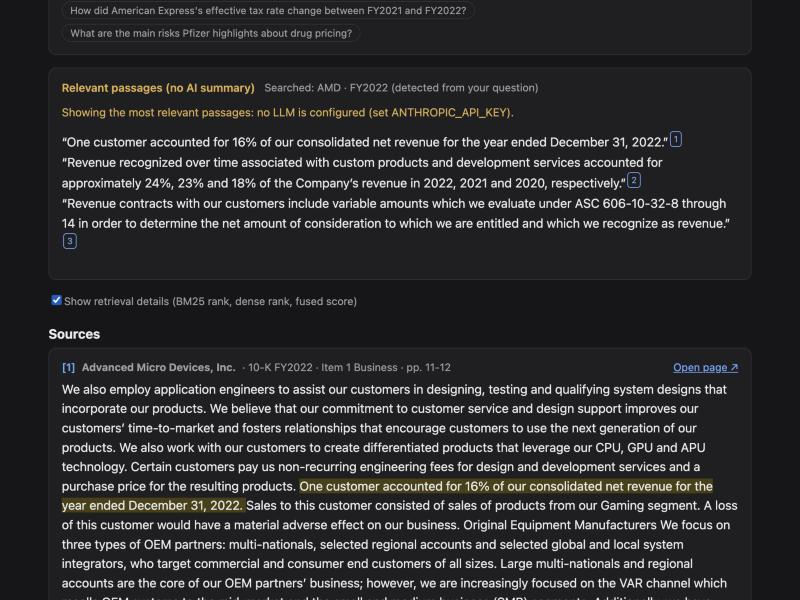
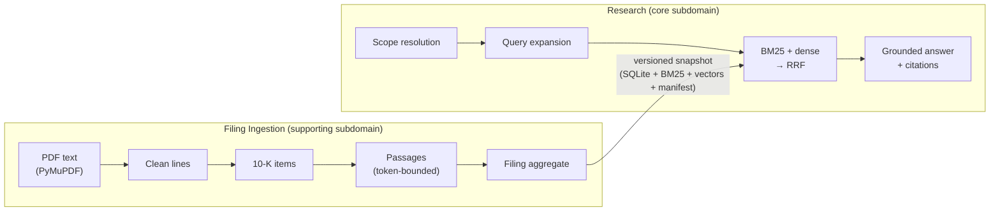

# NovaBridge Filings Q&A

Ask natural-language questions about SEC 10-K filings and get concise answers with **page-level, verifiable citations**.
Retrieval is **hybrid**: BM25 keyword search plus dense vector search, merged with Reciprocal Rank Fusion. An LLM
(Claude, with native citations) writes the answer only from the retrieved passages. Every claim links to the exact
sentence and to the original PDF page.



**Headline numbers** (33 FinanceBench questions with page-level ground truth, [details](#evaluation)):
- **Hybrid beats both retrievers alone.** It reaches Hit@10 **0.67** vs 0.58 (BM25) and 0.55 (dense), and MRR@10
  **0.32** vs 0.27 / 0.23.
- **Fast.** p50 retrieval latency is about **6 ms** on CPU.
- **Tested.** 270 fast tests, 4 slow tests (real embedding model) and 4 frontend tests; strict mypy; architecture rules
  enforced in CI.

---

## Contents

- [Quickstart](#quickstart)
- [Requirements traceability](#requirements-traceability)
- [Architecture](#architecture)
- [How the hybrid search works](#how-the-hybrid-search-works)
- [Answers and citations](#answers-and-citations)
- [Evaluation](#evaluation)
- [Ingestion: from PDF to passages](#ingestion-from-pdf-to-passages)
- [Design decisions and trade-offs](#design-decisions-and-trade-offs)
- [Testing](#testing)
- [API](#api)
- [Limitations and failure modes](#limitations-and-failure-modes)
- [Scaling and productionization](#scaling-and-productionization)
- [AI tools used](#ai-tools-used)
- [Data and licenses](#data-and-licenses)

---

## Quickstart

Requires Docker. No API key is needed: without one, answers quote the most relevant passages instead of a written
summary, and the UI says so.

```bash
cp .env.example .env              # optional: set ANTHROPIC_API_KEY=... for written answers
docker compose up --build         # ingest -> api -> web
```

| URL | What |
|---|---|
| http://localhost:8080 | The UI |
| http://localhost:8000/docs | OpenAPI documentation (try `POST /api/v1/questions`) |

What `docker compose up` does:
- **Build:** the first build takes a few minutes (CPU-only PyTorch, embedding model baked into the image).
- **`ingest`:** parses the 7 PDFs and publishes an index snapshot (about 1 minute on CPU). On later starts it detects
  the unchanged corpus and does nothing.
- **`api`, then `web`:** start once the previous service is ready.
- **Ports:** if a port is taken, use `WEB_PORT=8088 API_PORT=8001 docker compose up`.

**Local development** (Python 3.12 via [uv](https://docs.astral.sh/uv/), Node 24+):

```bash
make setup                        # backend and frontend dependencies
make ingest                       # build the index locally
make ask Q="Did AMD report customer concentration in FY22?"
make check                        # lint, format, strict types, architecture rules, tests
make eval                         # retrieval evaluation table
```

To run the app locally: `cd backend && uv run uvicorn filings_qa.entrypoints.http.main:app --port 8000`, then
`cd frontend && npm run dev`.

## Requirements traceability

| Requirement | Where |
|---|---|
| Python backend that ingests 10-K PDFs | [`ingestion/`](backend/src/filings_qa/ingestion) context, `filings-qa ingest`, compose `ingest` service |
| Question-answering API | `POST /api/v1/questions` ([`entrypoints/http/app.py`](backend/src/filings_qa/entrypoints/http/app.py)) |
| Hybrid search (keyword + semantic) | BM25 + dense retrievers, [RRF in the domain](backend/src/filings_qa/research/domain/fusion.py), [`HybridRetriever`](backend/src/filings_qa/research/application/hybrid_retriever.py) |
| LLM answer citing sources | [`ClaudeAnswerGenerator`](backend/src/filings_qa/research/adapters/claude_generator.py) (native citations) + [`GroundingPolicy`](backend/src/filings_qa/research/domain/grounding.py) |
| Frontend: ask, see answer and source passages | [`frontend/`](frontend/src) (React + Vite + TypeScript) |
| README: decisions, trade-offs, hybrid search, run instructions | This file + [ADRs](docs/adr) + [technical analysis](docs/technical-analysis.md) |
| AI assistant logs | [`docs/ai-logs/`](docs/ai-logs) and [AI tools used](#ai-tools-used) |
| Docker / Docker Compose | [`docker-compose.yml`](docker-compose.yml), [`backend/Dockerfile`](backend/Dockerfile), [`frontend/Dockerfile`](frontend/Dockerfile) |

## Architecture

A modular monolith in **hexagonal (ports and adapters)** style, with two **bounded contexts**:



- **Dependency rule.** The domain is pure Python (no FastAPI, NumPy, bm25s or Anthropic imports). Use cases depend on
  `typing.Protocol` ports. Adapters implement them. [`bootstrap.py`](backend/src/filings_qa/bootstrap.py) is the
  only place that wires concrete classes. [import-linter contracts](backend/pyproject.toml) check all of this in CI.
- **Layout.** `backend/src/filings_qa/{shared_kernel, ingestion/{domain,application,adapters},
  research/{domain,application,adapters}, infrastructure, entrypoints/{http,cli}, evaluation}`.
- **Shared kernel** (`FilingId`, `Ticker`, `FiscalYear`, `ItemCode`, `PageRange`). The contexts share nothing else
  and exchange data only through the published snapshot format.
- **Patterns, each for a reason:**
  - Composite: `HybridRetriever` is a `Retriever`.
  - Decorator: query expansion; the LLM fallback.
  - Strategy: RRF or convex fusion.
  - Specification: `SearchScope.admits`.
  - Anti-corruption layer: the Claude adapter.
  - Repository / read model: the snapshot reader.
- **Proportionate DDD.** Tactical patterns are used only where they enforce invariants: a passage must stay within its
  filing's pages, and a citation must point into the evidence. There is no CQRS, event sourcing or microservices
  ([ADR 0001](docs/adr/0001-hexagonal-architecture-and-bounded-contexts.md)).

## How the hybrid search works

For each question:

1. **Scope resolution.** Company names, aliases, tickers and possessives ("JnJ", "Pepsico", "AMEX's") and fiscal
   years ("FY22", "between FY2021 and FY2022") restrict the search to filings that actually exist. Explicit UI
   filters win. 10-K boilerplate is so similar across companies that without this, plausible evidence from the
   *wrong company* is the most common error. Detection is worth +9 points Hit@10.
2. **Query expansion.** Analyst vocabulary is translated into filing wording: "capex" becomes "purchases of property,
   plant and equipment"; "quick ratio" becomes "current assets, current liabilities, …". This is worth +9 points
   Hit@10 and +12 points MRR ([ADR 0006](docs/adr/0006-analyst-vocabulary-query-expansion.md)).
3. **Two retrievers, top 50 candidates each, both filtered by scope:**
   - **BM25** ([bm25s](https://github.com/xhluca/bm25s)) over a finance-aware tokenizer. It keeps `10-k`, `1a`,
     `covid-19` and `s&p` intact, drops thousands separators, stems words, and is best at exact line items and
     codes.
   - **Dense**: [bge-small-en-v1.5](https://huggingface.co/BAAI/bge-small-en-v1.5) embeddings and exact cosine
     search in NumPy. It handles paraphrase. Queries get the model's retrieval instruction, which has to be passed
     explicitly because the model's config defines none.
4. **Reciprocal Rank Fusion**, implemented as a pure, property-tested domain function:

   $$\mathrm{RRF}(d) = \sum_{r \in \{\text{bm25}, \text{dense}\}} \frac{1}{60 + \mathrm{rank}_r(d)}$$

   - **Why RRF:** BM25 scores are unbounded and depend on the query, while cosine similarities cluster in a narrow
     band. Adding raw scores lets one retriever dominate arbitrarily. RRF uses only ranks, needs no calibration and
     rewards agreement between retrievers.
   - **Convex combination** of normalized scores is implemented too, for comparison. RRF won on this data.
5. **Top 8 passages** become the evidence for the answer. Every hit keeps its provenance (BM25 rank, dense rank, fused
   score), shown in the API and behind the UI's "Show retrieval details" toggle.

Each passage is indexed with a **contextual header**, e.g. `Advanced Micro Devices, Inc. (AMD) · Form 10-K · FY2022 ·
Item 1 Business`, so "the Company" in one filing is distinguishable from the same words in another.

**Worked example:** "Did AMD report customer concentration in FY22?"
- **Scope:** AMD · FY2022, detected from the question.
- **Expansion:** "…customers accounted for percent of net revenue significant customers".
- **Ranks:** BM25 ranks the evidence page (Item 1, pp. 11–12) **3rd** and dense ranks it **2nd**. RRF puts it
  **1st**, because 1/63 + 1/62 beats any single first place (1/61).
- **The passage** contains "One customer accounted for 16% of our consolidated net revenue…".

**Why hybrid wins on average** (per-question first-relevant ranks):
- **Not on every question.** Hybrid beats both retrievers on 7 of 33 questions and trails the better one on 17.
- **But it is rarely badly wrong.** BM25 and dense fail badly on *different* questions:
  - for "largest liability in AmEx's balance sheet", BM25 ranks the evidence 40th and dense 2nd;
  - for "is Boeing's business cyclical?", BM25 ranks it 1st and dense 26th.
- **You can't know in advance** which retriever a question needs, and fusion keeps both in play.

## Answers and citations

- **Native citations.** Each evidence passage is sent to Claude as a `search_result` block whose content is split into
  sentences, with citations enabled. The API guarantees that citations point into the supplied passages, which is
  stronger than asking the model to write "[1]" markers. Quotes are rebuilt from our own sentences using the
  returned block indices, so they match the source exactly.
- **Grounding policy** (domain):
  - **Validation:** drops citations that point outside the evidence or quote text the passage lacks, and measures
    coverage.
  - **Status:** `grounded`, `partially_grounded` (the UI underlines uncited sentences), `insufficient_evidence`, or
    `extractive_fallback`.
  - **No evidence, no LLM call:** if nothing relevant is found, the LLM is not called.
- **Graceful degradation.** With no API key, or on rate limits, timeouts, outages or refusals, a Decorator switches
  to an extractive answer: the best-matching prose sentence of each top passage, quoted and cited, with a visible
  notice.
- **Model settings:** `claude-opus-5-5` (configurable via `LLM_MODEL`), `output_config.effort=medium` (`LLM_EFFORT`),
  a 60 s timeout, 2 SDK retries, and the server-side refusal fallback enabled. Prompt caching is not used: the stable
  prefix (the system prompt) is below the minimum cacheable size, and the evidence changes per question.
- **Verification in one click:** each source card has "Open page ↗", which serves the original PDF at the cited page
  (`/api/v1/filings/{id}/document#page=N`).

## Evaluation

`make eval` runs every configuration over the FinanceBench open-source questions for the indexed filings. A passage
counts as relevant when it comes from the right filing and its pages overlap an evidence page. FinanceBench pages are
0-based, so they are converted to our 1-based pages; this was verified on 37 of 40 evidence snippets.

| Configuration | Hit@1 | Hit@5 | Hit@10 | MRR@10 | Recall@10 | p50 latency |
|---|---|---|---|---|---|---|
| BM25 only | 0.15 | 0.42 | 0.58 | 0.27 | 0.55 | 0 ms |
| Dense only | 0.09 | 0.39 | 0.55 | 0.23 | 0.55 | 6 ms |
| **Hybrid, RRF (k=60)**: default | **0.18** | **0.58** | **0.67** | **0.32** | **0.64** | 6 ms |
| Hybrid, convex (α=0.3) | 0.15 | 0.48 | 0.55 | 0.27 | 0.52 | 6 ms |
| Hybrid, convex (α=0.5) | 0.15 | 0.42 | 0.64 | 0.28 | 0.61 | 6 ms |
| Hybrid, convex (α=0.7) | 0.12 | 0.48 | 0.58 | 0.26 | 0.58 | 6 ms |
| Hybrid, RRF, without query expansion | 0.06 | 0.42 | 0.58 | 0.20 | 0.53 | 6 ms |
| Hybrid, RRF, without scope detection | 0.15 | 0.45 | 0.58 | 0.28 | 0.56 | 7 ms |

How to read it:
- **Hybrid with RRF is the best configuration** on every metric. Scope detection and query expansion each add about
  9 points of Hit@10.
- **Rerankers were tried and rejected.** A cross-encoder over the hybrid top 50 *lowered* Hit@10 from 0.67 to 0.58
  (MiniLM-L6, +0.5 s latency). bge-reranker-base was worse and slower (+3 s) in an earlier run. General-purpose
  rerankers are trained on web QA, not "quick ratio" questions answered by balance-sheet tables.
- **Headroom remains.** The relevant passage is in the hybrid top 50 for 94% of questions, in the top 10 for 67%, and
  in the top 8 (what reaches the LLM) for 64%. A finance-tuned reranker or better table handling is the next lever.
- **Caveats, stated plainly:**
  - 33 questions is a small sample, so a difference of one or two questions is noise.
  - The analyst glossary was written after reading these questions, so its gain is in-sample.
  - Many FinanceBench questions need multi-step reasoning over financial tables, which is hard for any
    passage-retrieval system ([FinanceBench](https://arxiv.org/abs/2311.11944) reported GPT-4-Turbo with retrieval
    failing 81% of its questions).
- **Answer quality** (written answers, citation validity) will be measured once an API key is configured; the live
  test is `pytest -m live`.

## Ingestion: from PDF to passages

Every rule below was learned from the 7 real filings and is pinned by a regression test
([ADR 0007](docs/adr/0007-pdf-parsing-with-pymupdf.md)):

- **Page cleaning.** Unicode normalization handles the non-breaking spaces in "Item 1A" and ligatures. Running headers
  are lines at a page edge on at least 20% of pages. The threshold isn't 50% because exhibits dilute the 10-K's own
  header: PepsiCo's PDF is 549 pages, about 420 of them exhibits. Page numbers and words hyphenated across lines are
  also fixed.
- **Item detection.** A heading is "Item N" with a title matching that item, on the same line or the next.
  - Table-of-contents pages are skipped, recognized by page numbers after headings. Short items often share a page,
    so "many headings" alone is not the signal.
  - Items must appear in increasing order, and a heading never continues a sentence. This rejects Pfizer's
    "…see the / Item 1A. Risk Factors—… section" forward reference.
  - Combined headings ("ITEMS 10, 11, 12 and 13") are recognized.
  - Text before Item 1 is kept as the cover section, which answers questions such as AmEx's registered securities.
  - The 10-K ends at "SIGNATURES": **about 1,050 of 1,917 PDF pages are appended exhibits** and are not indexed.
- **Chunking.** Chunks never cross an item. Sentences are packed up to 350 tokens (counted with the embedder's own
  tokenizer) with 50 tokens of overlap, and over-long table rows are split. The longest indexed text is 394 tokens,
  safely under the model's 512.
- **Snapshot.** SQLite passages, the BM25 index, a vector matrix and a manifest are written to a staging directory,
  then made live with an atomic `CURRENT` pointer switch. A failed build never touches the live index.
  - The manifest records the embedding model, and the API refuses a snapshot built with a different one.
  - Ingestion is idempotent: a fingerprint of PDF hashes, metadata and pipeline settings skips unchanged corpora.

**Result:** 7 filings and 2,365 passages, in about 55–70 s on a laptop CPU.

## Design decisions and trade-offs

| Decision | Alternatives | Why / trade-off | ADR |
|---|---|---|---|
| Hexagonal monolith, 2 bounded contexts | Layered app; microservices | Clear seams, testable core; contexts are the future deployment split | [0001](docs/adr/0001-hexagonal-architecture-and-bounded-contexts.md) |
| Own RRF in the domain | LangChain `EnsembleRetriever`, engine-native fusion | The graded logic stays transparent, property-tested and explainable; more code to own | [0002](docs/adr/0002-hybrid-retrieval-with-reciprocal-rank-fusion.md) |
| Claude native citations + grounding policy + extractive fallback | Prompt-based `[n]` markers; structured JSON | Citations guaranteed to point into evidence; works without a key; no JSON (citations exclude structured outputs) | [0003](docs/adr/0003-native-citations-and-extractive-fallback.md) |
| Exact NumPy vector search | FAISS, Chroma, Qdrant | Same results at this scale in < 1 ms; FAISS + torch crash on macOS (duplicate OpenMP) | [0004](docs/adr/0004-exact-numpy-vector-search-instead-of-faiss.md) |
| FinanceBench corpus + golden set | Hand-picked recent 10-Ks | Ground truth enables real ablations; filings are 2021–2022 | [0005](docs/adr/0005-financebench-corpus-and-evaluation.md) |
| Analyst-vocabulary query expansion | Cross-encoder reranker; LLM query rewriting | +9 pts Hit@10 at no latency; the reranker lowered Hit@10 (0.67 → 0.58) at +0.5 s; in-sample caveat | [0006](docs/adr/0006-analyst-vocabulary-query-expansion.md) |
| PyMuPDF; 10-K structure as domain logic | pdfplumber, docling | Fast and accurate; **AGPL** needs a license decision for production | [0007](docs/adr/0007-pdf-parsing-with-pymupdf.md) |
| bge-small-en-v1.5, local | bge-base, hosted (e.g. Voyage `voyage-finance-2`) | Free, private, deterministic, fast on CPU; hosted finance models are one adapter away | |

**Why not LangChain or LlamaIndex?**
- **They hide the graded parts.** Fusion, grounding and citations are exactly what these frameworks abstract away.
- **Their types would leak in.** `Document`, `BaseRetriever` and similar types would enter the domain and break the
  ports.
- **They add churn.** Large, fast-moving dependency trees make deterministic tests harder.
- **What we lose:** fast experimentation and ready-made integrations. Any of their components can still be wrapped
  in an adapter later.

## Testing

Tests came first throughout: each unit's tests were committed before its implementation (see the git history).

| Level | What | Run |
|---|---|---|
| Domain unit tests | Value objects, cleaner, section detector, chunker, RRF and convex fusion, scope resolver, grounding, analyst vocabulary | `make test` |
| Property-based (Hypothesis) | RRF: union of inputs, monotonic scores, order independence, promotion never lowers a score. Chunker: token budget, no lost words | `make test` |
| Application | Use cases with in-memory fakes (no mocks of libraries) | `make test` |
| Contract | One `Retriever` suite run against the in-memory fake, BM25, dense and hybrid, over a snapshot built by the real ingestion side (substitutability made executable) | `make test` |
| Integration | Corpus manifest, PDF parser on generated PDFs, atomic snapshot store, Claude mapping on SDK-validated fixtures, error mapping | `make test` |
| API | Routes, validation, RFC 9457 problem details, readiness, PDF serving | `make test` |
| Slow | The real embedding model: dimensions, query instruction, token counting | `make test-slow` |
| Live | A real Claude call (needs `ANTHROPIC_API_KEY`) | `cd backend && uv run pytest -m live` |
| Frontend | Citation chips, plain-text rendering (no XSS), uncited claims, scope line | `make frontend-check` |
| Architecture | import-linter: layers per context, independent contexts, framework-free domain, entrypoints never import adapters | `make check` |

`make check` (and `make docker-check`, the same thing in a container) runs ruff, ruff format, **mypy --strict**,
import-linter and pytest. CI ([`.github/workflows/ci.yml`](.github/workflows/ci.yml)) runs the backend gate, the slow
tests, the frontend tests and build, and the Docker image builds.

## API

| Method and path | Purpose |
|---|---|
| `POST /api/v1/questions` | `{question, filters?: {tickers, fiscal_years, items}}` → answer segments, citations, evidence with retrieval ranks, resolved scope, timings |
| `POST /api/v1/search` | Retrieval only: `mode` = `hybrid`, `keyword` or `semantic`, to compare rankings |
| `GET /api/v1/filings` | Indexed filings (drives the UI filters) |
| `GET /api/v1/filings/{filing_id}/document` | The original PDF, inline (append `#page=N`) |
| `GET /health`, `GET /ready` | Liveness; readiness (snapshot loaded, which answer generator is active) |

Errors are RFC 9457 problem details (`application/problem+json`). Without an index the service stays alive, reports
not-ready, and tells you to run ingestion.

## Limitations and failure modes

| Area | Failure mode | Mitigation here | Production direction |
|---|---|---|---|
| Tables | Flattened text loses row/column structure; units can sit in another passage | Numbers stay searchable; the UI shows the source page | XBRL facts for figures; layout-aware parsing (docling) |
| Scanned PDFs | No text layer | Not handled (all 7 PDFs have text) | OCR |
| Wrong company | Similar boilerplate across 10-Ks | Scope detection, contextual headers, company in every citation | Entity linking, per-company retrieval for comparisons |
| "Nothing relevant" | RRF always returns a top-k | Grounding policy; the LLM is told to decline | Calibrated relevance thresholds |
| Questions needing many passages | "List all risk factors" exceeds the top 8 | Shows the best 8 with sources | Section-level map-reduce, agentic retrieval |
| Hallucination | Unsupported claims | Native citations, quote validation, uncited sentences flagged | Online faithfulness checks |
| Prompt injection in filings | Instructions in document text | Passages sent as data blocks; the system prompt says to ignore them; no tools | Content scanning |
| LLM outage or refusal | Errors, latency | SDK retries, timeout, server-side refusal fallback, extractive fallback | Circuit breaker, queueing |
| Index mismatch | Embedding model changed | Manifest check: the service refuses to become ready | Versioned indexes in CD |
| Security | No authentication; LLM output rendered in the browser | Internal use; output rendered as text (no HTML); secrets only in `.env`; non-root containers | SSO/OIDC, RBAC, audit log |
| Privacy | Questions reveal research interests | Question text is not logged | Zero-data-retention terms or a self-hosted model |

## Scaling and productionization

- **Corpus growth** (S&P 500 × 10 years ≈ 3M passages):
  - Move to OpenSearch, Qdrant or Vespa: BM25, approximate nearest-neighbour search and filters in one engine,
    sharded by company and year, with int8 or binary quantization.
  - Only the `Retriever` adapters change.
- **Ingestion pipeline:**
  - Driven by the EDGAR submissions feed, through a queue to workers, idempotent by accession number, with a
    dead-letter queue.
  - Parse EDGAR HTML/iXBRL instead of PDFs, and take figures from XBRL.
- **Query path:**
  - Stateless API replicas behind a load balancer; async I/O.
  - Caches for query embeddings and answers (keyed by question, scope and snapshot).
  - Streamed answers (SSE).
- **Quality:**
  - Grow the analyst glossary from question logs, or rewrite queries with an LLM.
  - Decompose comparison and multi-hop questions.
  - Finance-tuned embeddings.
  - Evaluation gate in CI, fed by analyst feedback.
- **Operations:**
  - OpenTelemetry traces per stage; LLM cost and latency dashboards.
  - Zero-downtime re-indexing: immutable snapshots with an atomic pointer swap now; blue/green indexes with aliases
    later.
- **Compliance:** SSO, audit trail (question, answer, cited sources, model, snapshot version), retention policies.

## AI tools used

- **Claude Code** (Claude Opus 5.5) was the pair programmer throughout:
  - analyzing the brief and writing the [technical analysis](docs/technical-analysis.md);
  - fact-checking library and dataset details (bm25s, FAISS, sentence-transformers, FinanceBench, SEC rules);
  - scaffolding the project and Docker;
  - writing tests and implementations in test-first steps;
  - studying the real PDFs to derive the cleaning and sectioning rules;
  - running the evaluations and experiments (reranker, query expansion);
  - drafting this README and the ADRs.
- **How output was checked.** Every change went through the quality gate (ruff, strict mypy, import-linter, tests)
  before being committed. Claims about libraries were verified against primary sources. The ingestion rules were
  validated on all 7 real filings, and retrieval changes were measured with the evaluation harness.
- **Logs:** the conversation logs are in [`docs/ai-logs/`](docs/ai-logs).

## Data and licenses

- **Filings:** 7 10-K PDFs (public SEC filings) obtained from
  [FinanceBench](https://github.com/patronus-ai/financebench) (Patronus AI), listed in
  [`data/corpus.yaml`](data/corpus.yaml).
- **Evaluation questions:** FinanceBench's open-source questions for these filings,
  [CC BY-NC 4.0](https://huggingface.co/datasets/PatronusAI/financebench), in
  [`backend/tests/eval/financebench_subset.jsonl`](backend/tests/eval/financebench_subset.jsonl).
- **PyMuPDF** is AGPL-3.0 (or a commercial license). See [ADR 0007](docs/adr/0007-pdf-parsing-with-pymupdf.md).
- **The original task brief** is in [`prescreen-brief-peter-boev.md`](prescreen-brief-peter-boev.md).
