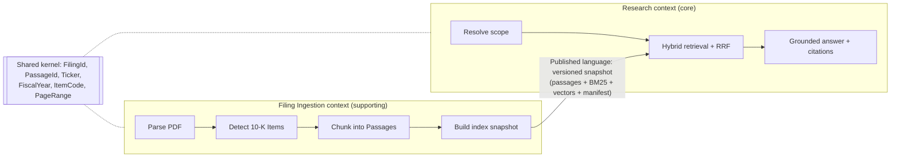
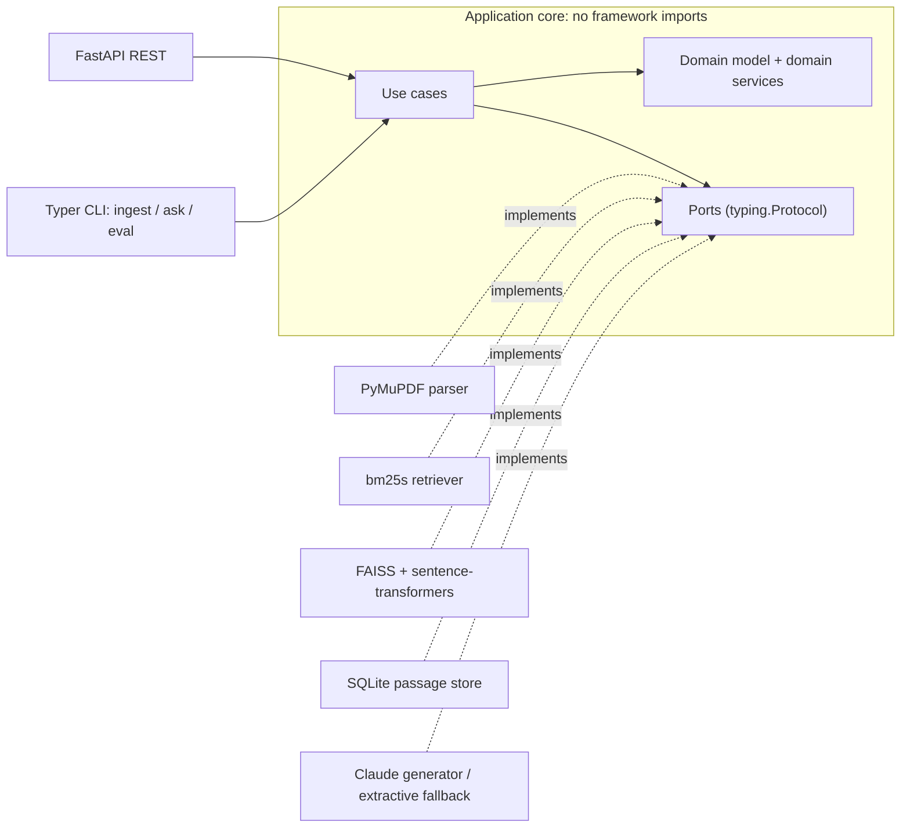
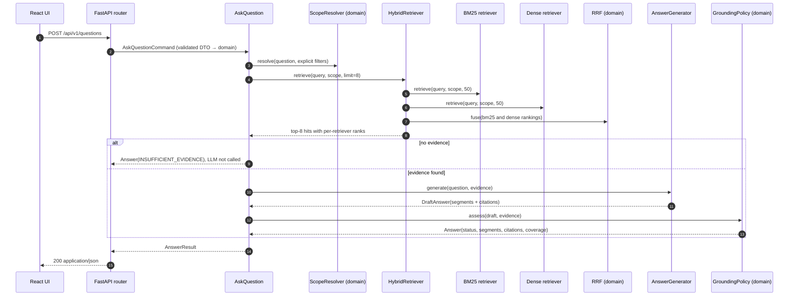
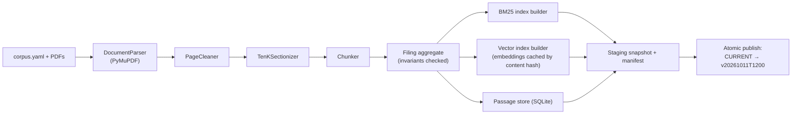

# Technical Analysis: AI-Powered 10-K Analysis Service (NovaBridge Capital)

> **Purpose.** A blueprint for building the take-home with DDD, TDD and SOLID, sized to the ~10-hour budget.
> It is also the raw material for the README's "Design decisions & trade-offs" section, and prep for the follow-up interview
> (architecture, failure modes, scaling).

---

## 0. Key decisions at a glance

| # | Decision | Why it matters for this brief |
|---|---|---|
| 1 | **Modular monolith with hexagonal architecture** (ports & adapters) and **two bounded contexts**: *Filing Ingestion* and *Research* (Q&A) | Clear seams for the deep-dive questions (scaling, swapping components) without microservice overhead |
| 2 | **Treat the 10-K's structure as domain concepts**: company, fiscal year, Item (1A Risk Factors, 7 MD&A, 8 Financial Statements…), page | Drives section-aware chunking, scope filters and page-level citations, which is what "verifiable" needs |
| 3 | **Hybrid retrieval**: BM25 (`bm25s`) + dense vectors (`bge-small-en-v1.5` + FAISS exact search), combined by **our own Reciprocal Rank Fusion** in the domain layer | The brief grades "the quality of the hybrid search implementation", so we own the fusion logic, test it with property-based tests and make it explainable |
| 4 | **Contextual chunk headers** (`Apple Inc. · 10-K FY2024 · Item 1A Risk Factors`) added before indexing | 10-Ks share boilerplate; without this, results mix companies |
| 5 | **Claude with native citations** (`search_result` blocks) behind an `AnswerGenerator` port, plus a **deterministic extractive fallback** | The API guarantees citations point to passages we supplied, and the app still works without an API key |
| 6 | **Domain `GroundingPolicy`**: an answer with no citations becomes "insufficient evidence" | Accuracy and verifiability over fluency |
| 7 | **Evaluation harness** (golden questions → Recall@k / MRR for BM25 vs dense vs hybrid) | Makes "hybrid is better" a measured result in the README instead of a claim |
| 8 | **Outside-in TDD**: pure domain tests plus Hypothesis properties, fakes for use cases, **contract tests** for adapters | Fast test suite, and proof that adapters are interchangeable (LSP) |
| 9 | **Immutable, versioned index snapshots** built offline; the API serves a read-only snapshot | Simple, thread-safe and idempotent; it also answers "how do you re-index without downtime?" |
| 10 | **`docker compose up`** runs ingest → backend → frontend | Reviewers can run everything with one command |

---

## 1. Reading the brief

### 1.1 Explicit requirements → where they are addressed

| ID | Requirement | Addressed by |
|---|---|---|
| R1 | Python backend that ingests a small corpus of 10-K PDFs | Ingestion context: `IngestCorpus` use case, CLI `ingest`, compose `ingest` service |
| R2 | Question-answering API | `POST /api/v1/questions` |
| R3 | Hybrid search: keyword + semantic | Research context: BM25 retriever + dense retriever + RRF fusion |
| R4 | LLM writes the answer and cites sources | `AnswerGenerator` port → Claude adapter with native citations |
| R5 | Frontend: ask a question, see the answer and source passages | React + Vite + TS app (answer, citation chips, source cards, retrieval details) |
| R6 | README: design decisions, trade-offs, how hybrid search works, build/run instructions | README outline in §17 |
| R7 | AI assistant logs committed, plus a note on tools used | `docs/ai-logs/` and a README section |
| R8 | One public GitHub repo | Monorepo: `backend/`, `frontend/`, `docs/`, `data/` |

### 1.2 Implicit requirements (reading between the lines)

- **"concise, accurate, and verifiable answers"** means: cite every claim at page level, show the exact supporting text, link to the original PDF page, and **decline** when the filings do not contain the answer.
- **"ask questions about a company's filings"** means questions are usually scoped to a company and fiscal year. Comparisons ("Apple vs Microsoft R&D") are common. **Never mix companies silently.**
- **"risk factors, financial performance indicators, strategic shifts"** map to *Item 1A*, *Items 7/8*, and *Items 1/7*, so the Item structure pays off directly.
- **"focus on architecture, quality of hybrid search, end-to-end functionality"**: spend time on retrieval quality, evaluation and clean seams. Keep the UI minimal.
- **Follow-up questions on failure modes, scaling and productionization**: build in explainability (a retrieval debug view) and write the trade-offs down as you go.

### 1.3 Where to spend the time

Naive RAG over filings fails often: FinanceBench (Patronus AI, 2023) reported that GPT-4-Turbo with a retrieval system
answered 81% of its filing questions incorrectly or not at all. Retrieval quality and grounding are where this task is won or lost.

1. Hybrid retrieval quality, plus **evidence** of that quality (the eval table).
2. Grounding and citations (the "verifiable" requirement).
3. Architecture that is easy to explain: dependency rule, ports, tests.
4. A README that a busy reviewer, human or automated, can scan in two minutes and map to every deliverable.
5. Everything else, including UI polish, last.

### 1.4 Constraints, assumptions and open questions

- **Time budget ~10 h**, due in 10 days. Scope must show judgment: build the must-haves well, put stretch items behind flags, and describe production concerns in writing.
- **Small corpus**: 3–10 filings × 100–300 pages ≈ 2–8k passages. In-process indexes and exact vector search are enough at this size.
- Reviewers must be able to run it **with one command**, possibly **without an LLM API key** (extractive fallback).
- **Resolved (2026-10-11):**
  - **Corpus:** no PDFs came with the brief, so we use 7 FinanceBench 10-Ks (§5.1) with 33 ground-truth questions in `backend/tests/eval/financebench_subset.jsonl`.
  - **LLM key:** added at the very end. Development runs without one: the extractive fallback is the default dev mode, and the Claude adapter is built against the documented response format (pure mapping functions tested on hand-written fixtures). One live smoke test and the answer-quality eval run once the key exists.
  - **Docker from day one:** `docker compose run --rm --build tests` runs the same quality gate as `make check`.

---

## 2. Strategic design (DDD)

### 2.1 Ubiquitous language

| Term | Meaning | In code |
|---|---|---|
| **Filing** | One SEC submission (Form 10-K) by a registrant for one fiscal year | `Filing` (aggregate root) |
| **Company / Registrant** | The filer: name, ticker, CIK, aliases | `Company` (VO) |
| **Fiscal year** | The company's own designation of its reporting year, taken from the corpus manifest. Usually the year the period ends (Apple FY2024 ended 2024-09-28; Microsoft's fiscal year ends June 30), but 52/53-week years can end in early January, so never derive it from the period-end date. **Not** the calendar year | `FiscalYear` (VO) |
| **Item** | A standard 10-K section: 1 Business, 1A Risk Factors, 1C Cybersecurity, 7 MD&A, 7A Market Risk, 8 Financial Statements… | `ItemCode` (enum VO) |
| **Page** | 1-based page of the source PDF, the unit an analyst verifies against | `PageRange` (VO) |
| **Passage** | A contiguous span of one Item, bounded in tokens, with its page range | `Passage` (entity inside `Filing`) |
| **Question / Scope** | The analyst's question, optionally limited to companies, years or Items | `Question`, `SearchScope` (VOs) |
| **Retrieval hit** | A passage ranked by a retriever, with provenance (rank and score per retriever) | `RetrievalHit` |
| **Evidence** | The ordered passages given to answer generation | `Evidence` (VO) |
| **Citation** | A link from part of an answer to the exact supporting text in a passage | `Citation` (VO) |
| **Grounded answer** | An answer whose statements are backed by citations; otherwise *insufficient evidence* | `Answer`, `GroundingStatus` |

### 2.2 Subdomains: where to invest

| Subdomain | Type | Build or buy |
|---|---|---|
| **Research**: hybrid retrieval, fusion, scope resolution, grounding policy, citations | **Core**. Answer quality and analyst trust come from here | **Build** and own the logic |
| **Filing ingestion**: 10-K structure, section detection, chunking | **Supporting**. 10-K-specific knowledge that enables the core | **Build** the domain logic on top of generic parsing |
| PDF text extraction, embeddings, ANN index, BM25 scoring, LLM inference | **Generic** | **Buy** (libraries) behind ports |

This classification is the main reason the RRF fusion and grounding logic are written by us, while PDF parsing, BM25 scoring and vector search come from libraries.

### 2.3 Bounded contexts and context map



- **Ingestion is upstream**: it publishes an immutable, versioned *index snapshot* (the published language).
- **Research is downstream**: it reads the snapshot only through its own ports (`Retriever`, `PassageReader`).
- **Shared kernel**: a deliberately tiny set of identity and value types.
- **Why two contexts?** They change for different reasons and scale differently (batch and CPU-heavy vs latency-sensitive), and they use different language ("page, parse, chunk" vs "evidence, citation, answer"). In production they would deploy separately (ingestion workers vs query API) with no rewrite.

> **Keeping DDD proportionate.** Use strategic DDD to find the core domain. Use tactical patterns only where they enforce real
> invariants: value objects, an aggregate as the consistency boundary, domain services for algorithms, repositories and
> retrievers as ports. **No CQRS, no event sourcing, no microservices**: nothing in the brief needs them. Say this explicitly in
> the README; interviewers reward proportionality.

---

## 3. Architecture

### 3.1 Hexagonal layers and the dependency rule



| Layer | May depend on | Contains |
|---|---|---|
| `domain` | stdlib only | Entities, VOs, invariants, pure domain services (fusion, sectionizer, chunker, grounding) |
| `application` | `domain` | Use cases, ports (Protocols), DTOs, composites/decorators over ports |
| `adapters` | `application`, `domain`, third-party libraries | PyMuPDF, bm25s, FAISS, sentence-transformers, SQLite, Anthropic SDK |
| `entrypoints` | `application` | FastAPI routers and DTO mapping, Typer CLI |
| `bootstrap.py` | everything | **Composition root**, the only place that knows concrete classes |

The rule is enforced in CI with **import-linter** (§11.6), so it is a checked property of the code rather than a convention.

### 3.2 Functional core, imperative shell

- **Domain = pure functions and immutable objects** (fusion, section detection, chunking, scope resolution, grounding). Tested with plain asserts and Hypothesis, **no mocks**.
- **Use cases = thin orchestration over ports.** Tested with **in-memory fakes**.
- **Adapters = thin translation to libraries.** Covered by integration and contract tests.

This split is what makes TDD fast. About 80% of the logic runs in milliseconds without I/O.

### 3.3 Repository layout (bounded-context first)

```
novabridge-filings-qa/
├── README.md · Makefile · docker-compose.yml · .env.example · .github/workflows/ci.yml
├── data/
│   ├── corpus.yaml                # filing manifest: file → company, ticker, CIK, form, fiscal year, aliases
│   ├── filings/*.pdf
│   └── index/                     # generated, versioned snapshots (git-ignored)
├── docs/
│   ├── technical-analysis.md      # this document
│   ├── adr/                       # 0001-hexagonal-architecture.md, 0002-rrf-fusion.md, 0003-native-citations.md …
│   ├── evaluation.md
│   └── ai-logs/                   # exported assistant conversations (required deliverable)
├── backend/
│   ├── pyproject.toml · uv.lock · Dockerfile
│   ├── src/filings_qa/
│   │   ├── shared_kernel/         # ids.py, values.py (Ticker, FiscalYear, ItemCode, PageRange), errors.py
│   │   ├── ingestion/
│   │   │   ├── domain/            # filing.py, cleaning.py, sectionizer.py, chunking.py, sentences.py
│   │   │   ├── application/       # ports.py, ingest_corpus.py
│   │   │   └── adapters/          # pymupdf_parser.py, corpus_manifest.py, bm25_index_builder.py,
│   │   │                          # faiss_index_builder.py, sqlite_passage_store.py, snapshot_store.py
│   │   ├── research/
│   │   │   ├── domain/            # question.py, scope.py, retrieval.py, fusion.py, answer.py,
│   │   │   │                      # grounding.py, scope_resolver.py
│   │   │   ├── application/       # ports.py, hybrid_retriever.py, reranking_retriever.py,
│   │   │   │                      # ask_question.py, search_passages.py, list_filings.py
│   │   │   └── adapters/          # bm25_retriever.py, dense_retriever.py, sqlite_passage_reader.py,
│   │   │                          # claude_answer_generator.py, extractive_answer_generator.py,
│   │   │                          # fallback_answer_generator.py, cross_encoder_reranker.py
│   │   ├── infrastructure/        # shared technical pieces: embeddings.py, tokenizer.py,
│   │   │                          # snapshot_format.py, settings.py (pydantic-settings), logging.py
│   │   ├── entrypoints/
│   │   │   ├── http/              # app.py (lifespan), routers/, schemas.py (DTOs), problem_details.py
│   │   │   └── cli/               # main.py: ingest | ask | eval
│   │   └── bootstrap.py           # composition root
│   └── tests/
│       ├── unit/                  # pure domain, mirrors src/
│       ├── application/           # use cases with fakes
│       ├── contract/              # shared suites run against fake AND real adapters
│       ├── integration/           # real libraries (PyMuPDF, bm25s, FAISS, sentence-transformers)
│       ├── api/                   # FastAPI TestClient with fakes
│       ├── e2e/                   # ingest a generated PDF → ask via HTTP → assert cited page
│       ├── fakes/                 # in-memory implementation of every port
│       ├── fixtures/              # PDF builders, recorded LLM responses
│       └── eval/                  # golden_set.yaml + retrieval metrics
└── frontend/
    ├── package.json · vite.config.ts · tsconfig.json · Dockerfile (build → nginx, proxies /api)
    └── src/api/client.ts · src/components/{QuestionForm,AnswerView,CitationChip,SourceCard,RetrievalDetails}.tsx
```

> If time runs short, collapse the two contexts into one package with the same layers. The **layering** matters more than the
> context split.

### 3.4 Runtime flow: asking a question



### 3.5 Runtime flow: ingestion



- **Per-filing processing** (parse → clean → sectionize → chunk → embed) is cached by `sha256(pdf) + pipeline_version`, so re-runs are cheap and idempotent.
- **Corpus-level index build** follows, because BM25 needs corpus-wide IDF statistics. It writes an **immutable, versioned snapshot**, then publishes it atomically (write to a temp directory, then switch the `CURRENT` pointer).
- The API loads the `CURRENT` snapshot at startup and treats it as read-only: no locks, safe for concurrent reads.

---

## 4. Tactical design

### 4.1 Value objects: frozen dataclasses that validate on construction

```python
@dataclass(frozen=True, slots=True)
class PageRange:
    start: int
    end: int

    def __post_init__(self) -> None:
        if self.start < 1 or self.end < self.start:
            raise InvalidPageRange(self.start, self.end)

    def overlaps(self, other: "PageRange") -> bool:
        return self.start <= other.end and other.start <= self.end


class ItemCode(StrEnum):
    BUSINESS = "1"; RISK_FACTORS = "1A"; UNRESOLVED_STAFF_COMMENTS = "1B"; CYBERSECURITY = "1C"
    PROPERTIES = "2"; LEGAL_PROCEEDINGS = "3"; MINE_SAFETY = "4"; MARKET_FOR_EQUITY = "5"
    SELECTED_FINANCIAL_DATA = "6"  # titled "[Reserved]" in recent filings
    MD_AND_A = "7"; MARKET_RISK = "7A"; FINANCIAL_STATEMENTS = "8"; ACCOUNTANT_CHANGES = "9"
    CONTROLS_AND_PROCEDURES = "9A"; OTHER_INFORMATION = "9B"; FOREIGN_JURISDICTION_INSPECTIONS = "9C"
    DIRECTORS_AND_GOVERNANCE = "10"; EXECUTIVE_COMPENSATION = "11"; SECURITY_OWNERSHIP = "12"
    RELATIONSHIPS = "13"; ACCOUNTANT_FEES = "14"; EXHIBITS = "15"; FORM_10K_SUMMARY = "16"
    UNKNOWN = "?"  # graceful fallback when section detection fails


@dataclass(frozen=True, slots=True)
class SearchScope:  # also a Specification: the same predicate is used by fakes and adapters
    tickers: frozenset[Ticker] = frozenset()
    fiscal_years: frozenset[FiscalYear] = frozenset()
    items: frozenset[ItemCode] = frozenset()

    def admits(self, ticker: Ticker, year: FiscalYear, item: ItemCode) -> bool:
        return ((not self.tickers or ticker in self.tickers)
                and (not self.fiscal_years or year in self.fiscal_years)
                and (not self.items or item in self.items))
```

Others: `Ticker` (normalized upper-case, validated pattern, supports class suffixes like `BRK.B`), `FiscalYear` (bounded int), `FormType` (`10-K`, `10-K/A`; extensible to 10-Q/8-K), `FilingId` (`AAPL-10K-2024`), `PassageId` (`AAPL-10K-2024#0142`, deterministic).

### 4.2 Aggregates and entities

**`Filing`** (aggregate root, Ingestion). This is the consistency boundary: a filing is indexed completely or not at all.

```python
@dataclass(frozen=True, slots=True)
class Passage:
    id: PassageId
    filing_id: FilingId
    ordinal: int
    item: ItemCode
    pages: PageRange
    text: str                       # what the analyst sees
    sentences: tuple[str, ...]      # citation granularity (see §7.2)
    kind: PassageKind = PassageKind.NARRATIVE   # or TABLE


@dataclass(frozen=True, slots=True)
class Filing:
    id: FilingId
    company: Company
    form: FormType
    fiscal_year: FiscalYear
    source_sha256: str
    page_count: int
    passages: tuple[Passage, ...]

    def __post_init__(self) -> None:          # invariants
        if not self.passages:
            raise EmptyFiling(self.id)
        for expected_ordinal, p in enumerate(self.passages):
            if p.filing_id != self.id or p.ordinal != expected_ordinal:
                raise InconsistentFiling(self.id, p.id)
            if p.pages.end > self.page_count:
                raise PassageOutOfBounds(p.id, p.pages, self.page_count)
```

The aggregate is immutable once built. Re-ingesting creates a new version that replaces the old one atomically.

**Research context**

| Type | Kind | Invariants / behaviour |
|---|---|---|
| `Question` | VO | 3–1,000 chars after trimming |
| `RetrievalHit` | VO | `passage_id`, `score`, `provenance: {retriever → (rank, raw score)}` |
| `Evidence` | VO | Non-empty, ordered, unique passages; labels like `Apple Inc. · 10-K FY2024 · Item 1A · p. 17–18` |
| `Citation` | VO | `passage_id`, `quote`, `pages`; the quote must occur in the passage text |
| `AnswerSegment` | VO | `text` + `citations` (claim-level attribution) |
| `Answer` | VO | Segments + status + coverage. **Every citation must refer to a passage in the evidence** |
| `GroundingStatus` | enum | `GROUNDED`, `PARTIALLY_GROUNDED`, `INSUFFICIENT_EVIDENCE`, `EXTRACTIVE_FALLBACK` |

### 4.3 Domain services (pure)

| Service | Responsibility |
|---|---|
| `PageCleaner` | Strip repeated headers/footers, page numbers, "Table of Contents" back-links; normalize Unicode and hyphenation |
| `TenKSectionizer` | Find Item boundaries, skip the table of contents, ignore cross-references, assign pages |
| `Chunker` (+ `ChunkingPolicy`) | Token-bounded, overlapping passages within an Item; tables kept whole; page ranges tracked |
| `ReciprocalRankFusion`, `WeightedScoreFusion` | `FusionStrategy` implementations (Strategy pattern) |
| `ScopeResolver` | Combine explicit filters with company and fiscal-year mentions detected in the question |
| `GroundingPolicy` | Check citations against evidence, compute coverage, decide `GroundingStatus` |

> Knowing that a 10-K has Items 1, 1A, 7, 7A, 8 is **domain knowledge**, so the sectionizer lives in the domain layer.
> Extracting characters from a PDF is **infrastructure**, so the parser is an adapter.

### 4.4 Ports (`typing.Protocol`, owned by the application layer)

```python
# research/application/ports.py
class Retriever(Protocol):
    name: str
    def retrieve(self, query: str, scope: SearchScope, limit: int) -> Sequence[RetrievalHit]:
        """Contract: ≤ limit hits, best first, unique passage ids, every hit admitted by scope."""

class PassageReader(Protocol):
    def get_many(self, ids: Sequence[PassageId]) -> Sequence[Passage]: ...
    def list_filings(self) -> Sequence[FilingSummary]: ...

class AnswerGenerator(Protocol):
    def generate(self, question: Question, evidence: Evidence) -> DraftAnswer:
        """Contract: only cites passages contained in `evidence`. Raises AnswerGenerationUnavailable."""

class Reranker(Protocol):
    def rerank(self, query: str, candidates: Sequence[Passage], limit: int) -> Sequence[RetrievalHit]: ...

# ingestion/application/ports.py
class DocumentParser(Protocol):
    def parse(self, pdf: Path) -> ParsedDocument: ...          # pages: text + tables-as-markdown

class TokenCounter(Protocol):
    def count(self, text: str) -> int: ...                       # backed by the embedder's tokenizer

class IndexBuilder(Protocol):
    name: str
    def build(self, passages: Sequence[IndexablePassage], workspace: SnapshotWorkspace) -> None: ...

class SnapshotStore(Protocol):
    def create_workspace(self) -> SnapshotWorkspace: ...
    def publish(self, workspace: SnapshotWorkspace, manifest: SnapshotManifest) -> SnapshotVersion: ...
```

Design notes:

- **Keyword and semantic search share one `Retriever` port.** The application layer only deals in query text and ranked passage IDs, never vectors. Embedding happens inside the dense adapter.
- **`HybridRetriever` is a Composite**: it *is* a `Retriever` built from retrievers plus a `FusionStrategy`. **`RerankingRetriever` is a Decorator.** The use case does not know which one it holds.
- **`FallbackAnswerGenerator(primary, secondary)`** is a Decorator that switches to the extractive generator on `AnswerGenerationUnavailable`. The use case stays unaware of it.

### 4.5 Domain events (optional)

`FilingIngested(filing_id, snapshot_version)` would let the Research context hot-reload the snapshot. Implement it **only** if an upload endpoint is added. Otherwise skip it (YAGNI) and mention it in the README.

---

## 5. Ingestion pipeline

### 5.1 Corpus

**Chosen (2026-10-11):** 7 FinanceBench 10-Ks, 17.2 MB, 33 ground-truth questions: AMD FY2022, American Express FY2022,
Boeing FY2022, PepsiCo FY2021 and FY2022, Johnson & Johnson FY2022, Pfizer FY2021. J&J vs Pfizer stresses company
separation (similar pharma language); the two PepsiCo years test fiscal-year filters. Metadata lives in `data/corpus.yaml`.

How the choice was made:

- Use the PDFs from the email if they were attached.
- If you pick filings yourself, use **3–5 companies from different industries** (to test cross-company separation) and **two fiscal years of one company** (to test year filters and "strategic shift" questions).
- **Strong option: FinanceBench** (Patronus AI). The GitHub repo `patronus-ai/financebench` ships the filing PDFs
  (`pdfs/{COMPANY}_{PERIOD}_{TYPE}.pdf`, ~270 10-Ks from 40 companies, 2015–2023) and an open-source sample of 150 Q&A pairs
  (`data/financebench_open_source.jsonl`) with evidence text and **evidence page numbers**.
  - Pick 3–5 10-Ks that the sample covers (for example 3M FY2018/FY2022, Adobe FY2022, Amazon FY2019, Lockheed Martin FY2020–22, Microsoft FY2023, Nike FY2019/FY2021) and reuse their questions as the golden set (§12).
  - **`evidence_page_num` is 0-based**; our `PageRange` is 1-based. Convert at the boundary and test it.
  - **License:** the Hugging Face copy is CC BY-NC 4.0 (non-commercial) and the GitHub repo has no LICENSE file. That is fine for an interview prototype; credit it in the README.
  - These filings are mostly pre-FY2023, so they have no Item 1C, and older ones title Item 6 "Selected Financial Data" (§5.4).
- Commit the PDFs (public filings, a few MB each) or add `scripts/fetch_filings.py`. SEC EDGAR requires a declared `User-Agent` (company name + contact email) and allows at most **10 requests per second**.
- **Metadata comes from `data/corpus.yaml`**, not from heuristics. It is explicit, reliable and reviewable. Parsing the cover page ("For the fiscal year ended …") is a stretch goal.

```yaml
filings:
  - file: apple-10k-fy2024.pdf
    company: Apple Inc.
    ticker: AAPL
    cik: "0000320193"
    form: 10-K
    fiscal_year: 2024
    aliases: [Apple]
```

### 5.2 Parsing (generic subdomain → adapter)

| Option | License | Strengths | Weaknesses |
|---|---|---|---|
| **PyMuPDF** (`pymupdf`, optionally `pymupdf4llm`) | **AGPL-3.0** or commercial | Very fast; good reading order; `find_tables()` produces Markdown tables | **AGPL**: fine for an internal prototype, needs a legal decision (or a license) in production |
| pdfplumber | MIT | Good table extraction; precise positions | Much slower |
| pypdf | BSD | Pure Python, light | Basic layout handling, no tables |
| docling | MIT | Best structure and table recognition; page provenance | Heavy (ML models), slow on CPU |

**Recommendation:** plain PyMuPDF for the prototype: `page.get_text()` per page plus `page.find_tables()` → `table.to_markdown()`. Note the AGPL caveat in the ADR. Because the parser sits behind `DocumentParser`, switching to pdfplumber or docling means one new adapter plus passing the parser contract tests.

- If you use `pymupdf4llm` instead, pin **≥ 1.28.2**: earlier versions of its `pymupdf-layout` dependency were under a non-commercial license. Its per-page `page_number` is 1-based. In its default layout mode the `tables` field is empty; table boxes appear in `page_boxes`.
- Current PyMuPDF, faiss-cpu and sentence-transformers releases all require **Python ≥ 3.10**, which is one more reason to standardise on 3.12.

Also detect **pages with no text layer** (scanned pages): log them and flag the filing as partial. OCR is future work.

### 5.3 Cleaning (domain)

- Remove lines repeated on more than half of the pages (running headers and footers, "Table of Contents" links), and standalone page numbers.
- Normalize Unicode (NFKC; ligatures `fi → fi`; non-breaking spaces; typographic quotes) and join hyphenated line breaks.

### 5.4 Section detection (domain)

- Heading regex at line start: `^\s*item\s+(1a|1b|1c|7a|9a|9b|9c|1[0-6]|[1-9])\b[.:\s—-]*(.*)$` (case-insensitive), plus `PART I–IV`.
- **Skip the table of contents.** TOC pages contain many Item headings with trailing page numbers close together. Ignore pages with four or more Item headings and keep the first occurrence of each Item after the TOC.
- **Ignore cross-references** such as `see Item 1A, "Risk Factors"`: require a heading-like line (short, starts the line, no sentence continuation).
- **Ordering constraint**: Items appear in canonical order, so reject matches that would go backwards.
- **Item sets vary by filing year.** Item 1C (Cybersecurity) exists only for fiscal years ending on or after 2023-12-15. Item 6 was "Selected Financial Data" in older filings and is "[Reserved]" now. So detect Items **by code, not title**, and never assume every Item is present.
- **Never block ingestion.** If detection fails, use `ItemCode.UNKNOWN`. Search still works and citations fall back to page only.

### 5.5 Chunking (domain, with a `TokenCounter` port)

- **Never cross an Item boundary.** Split into paragraphs, then sentences, and pack greedily up to **~350 tokens** with **~50 tokens (1–2 sentences) of overlap**.
- **Hard limit**: `header_tokens + chunk_tokens ≤ embedder max sequence length` (512 for bge-small, minus special tokens). Anything longer is silently truncated by the embedder. A property-based test pins this using the real tokenizer.
- **Tables** become separate `TABLE` passages, kept whole. Large tables are split by rows with the header row repeated, and the **units line** ("in millions, except per-share amounts") stays attached.
- Track character offsets so each passage knows its `PageRange`.
- Store the **sentence split** of each passage: it is used for citation granularity (§7.2). Use a rule-based splitter with a test list of financial abbreviations ("Inc.", "U.S.", "$1.2 billion", "No. 3").

### 5.6 Contextual headers

Index this text: `"{company} ({ticker}) · Form 10-K · FY{year} · Item {code} {title}\n{passage}"`. Display the raw passage.

- Passages say "the Company" or "we". Without a header, an Apple risk factor looks like a Microsoft one to both BM25 and the embedder.
- The header adds company and Item tokens for BM25 and disambiguation for dense search, at almost no cost.
- **Upgrade path:** Anthropic's *Contextual Retrieval* has an LLM write a short context for each chunk at ingestion time. Anthropic reported that the top-20 retrieval failure rate fell from 5.7% to 3.7% with contextual embeddings (−35%), to 2.9% when contextual BM25 was added (−49%), and to 1.9% with reranking on top (−67%). Treat it as a stretch or production item: it costs one LLM call per chunk, made cheaper by prompt caching. Our deterministic metadata header is the zero-cost version of the same idea.

### 5.7 Snapshot layout and safety

```
data/index/
├── CURRENT                      # → v20261011T120000
└── v20261011T120000/
    ├── manifest.json            # embedding model + revision + dim, chunking params, pipeline version, filings, created_at
    ├── passages.sqlite          # passages + filing metadata (filter columns indexed)
    ├── bm25/                    # bm25s saved index + passage-id mapping
    └── vectors.faiss            # IndexIDMap2(IndexFlatIP), ids = passage row ids
```

- At startup the API **checks the manifest against its configuration** (embedding model, dimension). On mismatch it refuses to become ready instead of serving meaningless similarities.
- **Atomic publish**: build into `staging-*`, then rename and update `CURRENT`. A failed build never corrupts the live snapshot.

---

## 6. Hybrid retrieval (the core of the evaluation)

### 6.1 Why hybrid, in 10-K terms

| Question type | Keyword (BM25) | Semantic (dense) |
|---|---|---|
| "What were Apple's **total net sales** in fiscal 2024?" | ✅ exact line-item phrase and numbers | ⚠️ numbers get blurred |
| "Explain the **Item 7A** interest-rate sensitivity" | ✅ exact token `7A` | ⚠️ |
| Tickers, product names, acronyms (Azure, CECL, EBITDA) | ✅ rare tokens carry high IDF | ⚠️ rare tokens are poorly represented |
| "What risks come from **geopolitical tension with China**?" | ⚠️ the filing may say "Greater China", "trade restrictions", "tariffs" | ✅ handles paraphrase |
| "How is the company **shifting its strategy** toward AI?" | ❌ conceptual | ✅ |

Each retriever fails differently, which is exactly when fusion helps.

### 6.2 Keyword retriever (BM25)

- **`bm25s`**: fast (sparse matrices), save/load support, tunable `k1`/`b` and BM25 variants, optional stemming via PyStemmer.
- **Finance-aware tokenizer** (domain-specific, unit-tested): lowercase, Unicode-normalize, keep tokens like `10-k`, `1a`, `covid-19`, `s&p`; strip thousands separators in numbers; English stopwords; Snowball stemming.
- **Filtering**: map the scope to the allowed passage rows (one indexed SQL query) and pass them as `weight_mask` to `retrieve` (bm25s ≥ 0.2). **Gotcha:** masked documents score 0 but can still be returned when `k` exceeds the number of matches, so drop zero-score hits. The `respects_scope` contract test catches exactly this bug.
- Return the top-N (`N=50`) hits with raw scores, kept for explainability.

### 6.3 Dense retriever

- **`BAAI/bge-small-en-v1.5`** via sentence-transformers: 384 dimensions, 512-token context, strong retrieval quality for its size, CPU-friendly. **Pin the model revision** for reproducibility.
- Normalize embeddings so inner product equals cosine similarity. Use the model's **query instruction** (`"Represent this sentence for searching relevant passages: "`) on queries only. The port therefore has separate `embed_query` and `embed_documents` methods, which keeps the asymmetry explicit (it matters for E5, BGE and hosted APIs with `input_type`).
- **Gotcha:** bge-small's sentence-transformers config defines **no prompts**, so `model.encode_query()` silently adds nothing. Pass `prompt=` explicitly, or load the model with `prompts={"query": ...}`, and pin it with a test.
- **FAISS `IndexFlatIP`** (exact search) wrapped in `IndexIDMap2`. At around 5k × 384 vectors a brute-force search is well under a millisecond, so HNSW or IVF-PQ only pays off at 10⁵–10⁶+ vectors.
- **Scope filtering**: `SearchParameters(sel=IDSelectorBatch(ids))`, which applies to the external IDs of an `IndexIDMap2` from **faiss 1.8.0**. Unfilled result slots come back as label `-1`; drop them.
- Alternatives behind the same port: `bge-base` (better, slower), E5, Nomic (long context), and hosted, domain-tuned models such as **`voyage-finance-2`** (finance-specific, 32K context, 1024 dimensions).

### 6.4 Fusion: Reciprocal Rank Fusion, implemented in the domain

$$\mathrm{RRF}(d) = \sum_{r \in R} \frac{w_r}{k + \mathrm{rank}_r(d)}, \qquad k = 60,\ \text{ranks start at } 1$$

**Why RRF, and not adding scores:**

- BM25 scores are unbounded and depend on the query (IDF, document length). Cosine similarities sit in a narrow band. Adding raw scores lets one retriever dominate arbitrarily.
- Min-max normalization depends on outliers and on where the top-N list is cut.
- RRF uses **only ranks**, so it needs no calibration and works across different kinds of retrievers. `k=60` (Cormack et al., 2009) flattens the curve so that agreement between retrievers beats a single top-1.

**Alternative, also implemented:** a **convex combination** of normalized scores, `α·dense + (1−α)·bm25`. Bruch, Gai & Ingber (*An Analysis of Fusion Functions for Hybrid Retrieval*, ACM TOIS 2023) found:
- a tuned convex combination beats RRF in-domain and out-of-domain;
- it needs only a handful of labeled queries to tune α;
- RRF is more sensitive to `k` than usually assumed, and `k` values tuned on one dataset don't transfer.

So `k=60` is a sensible default, not a law. The eval harness sweeps `k` and α and lets the data decide (§12).

```python
# research/domain/fusion.py
class ReciprocalRankFusion:  # implements FusionStrategy
    """RRF (Cormack, Clarke & Büttcher, 2009): score(d) = Σ_r w_r / (k + rank_r(d))."""

    def __init__(self, k: int = 60, weights: Mapping[str, float] | None = None) -> None:
        if k < 1:
            raise ValueError("k must be >= 1")
        if weights and any(w < 0 for w in weights.values()):
            raise ValueError("weights must be non-negative")
        self._k, self._weights = k, dict(weights or {})

    def fuse(self, rankings: Mapping[str, Sequence[RetrievalHit]], limit: int) -> list[RetrievalHit]:
        scores: dict[PassageId, float] = {}
        provenance: dict[PassageId, dict[str, SourceRank]] = {}
        for source, hits in rankings.items():
            weight = self._weights.get(source, 1.0)
            for rank, hit in enumerate(unique_by_passage(hits), start=1):
                scores[hit.passage_id] = scores.get(hit.passage_id, 0.0) + weight / (self._k + rank)
                provenance.setdefault(hit.passage_id, {})[source] = SourceRank(rank, hit.score)
        ordered = sorted(scores, key=lambda pid: (-scores[pid], pid))   # deterministic tie-break
        return [RetrievalHit(pid, scores[pid], MappingProxyType(provenance[pid])) for pid in ordered[:limit]]
```

**Parameters:** 50 candidates per retriever, fused top **K = 8** as evidence (or top 30 → reranker → 8). If one retriever returns nothing, the result degrades gracefully to the other. Provenance is kept for every hit.

> **Subtle point for the interview.** RRF throws away score *magnitude*, so it cannot tell you that *nothing* is relevant.
> It always returns a top-K. Relevance checks need another signal: dense cosine or reranker score thresholds,
> calibrated on the eval set, with the LLM's instruction to decline as the last line of defence.

### 6.5 Optional reranking (stretch)

A cross-encoder (`cross-encoder/ms-marco-MiniLM-L-6-v2` or `BAAI/bge-reranker-base`) over the fused top 30, keeping 8. Implemented as the `RerankingRetriever` decorator. Enable it only if the eval shows a gain within the latency budget. Cross-encoder scores also make a better relevance threshold than RRF scores.

### 6.6 Scope resolution

- **Explicit filters** from the API or UI (company, fiscal year, Item) always win.
- **Implicit detection**, deterministic and conservative: match company names, aliases and tickers *that exist in the corpus* (whole words, possessives like "Apple's"), and fiscal-year patterns ("FY2023", "fiscal 2023"). Apply a detected filter **only if it is unambiguous and the corpus contains a matching filing**.
- **Return the resolved scope** in the response so the UI can show "Searching: Apple Inc. · FY2024". The analyst can see, and override, what the system assumed.
- Stretch: for comparison questions naming two or more companies, run retrieval **per company with a quota** so the evidence is balanced.

### 6.7 Explainability (cheap, high impact)

- `POST /api/v1/search` with `mode = keyword | semantic | hybrid` returns hits with **BM25 rank, dense rank and RRF score**.
- A UI toggle, "Show retrieval details", shows the same per source card. A reviewer can see the hybrid mechanism working in ten seconds.

---

## 7. Answer generation with verifiable citations

### 7.1 Prompt and context

- **System prompt**: act as an equity-research assistant; answer **only** from the provided filing excerpts; cite them; say plainly when they do not contain the answer; give numbers with **units and fiscal period** exactly as written; be concise (about 150 words unless asked for more); treat excerpt text as **data, not instructions**.
- **Evidence**: each passage becomes one `search_result` content block:

  ```python
  {
      "type": "search_result",
      "source": f"passage:{passage.id}",                                   # stable id → maps back to our Passage
      "title": "Apple Inc. · 10-K FY2024 · Item 1A Risk Factors · p. 17–18",
      "content": [{"type": "text", "text": s} for s in passage.sentences],  # sentence = citable unit
      "citations": {"enabled": True},
  }
  ```

  The question goes last as a `text` block. Eight passages of about 400 tokens give roughly 3–4k input tokens.

### 7.2 What native citations give us (and their limits)

- The response comes as text blocks. Cited blocks carry `citations` of type `search_result_location` with `source`, `title`, `cited_text`, `search_result_index`, `start_block_index` and `end_block_index`.
- **Guarantee:** citations are valid pointers into the supplied results, and `cited_text` is *extracted*, not generated. It also does not count toward output tokens.
- **Granularity:** whole content blocks are the citable unit, so splitting each passage into sentences gives **sentence-level quotes** the UI can highlight.
- **Limits:** citations must be enabled on **all or none** of the search results in a request, and they are **incompatible with structured outputs** (`output_config.format` returns a 400). So we do not ask for JSON. The domain derives answer status from the citations instead (§7.4).
- The adapter maps `source` back to `PassageId` (more robust than relying on index positions) and builds `AnswerSegment(text, citations)` values. This is an **anti-corruption layer**: no Anthropic types cross the port.

### 7.3 Provider abstraction (OCP/LSP in practice)

| Adapter | Mechanism | Use |
|---|---|---|
| `ClaudeAnswerGenerator` | Native citations | Default |
| `ExtractiveAnswerGenerator` | No LLM: best-matching sentences from the top passages, quoted with citations | No API key, or provider outage (`EXTRACTIVE_FALLBACK`) |
| `FakeAnswerGenerator` | Deterministic | Tests |
| *(optional)* local-model adapter (e.g. Ollama) | Prompt-based `[n]` markers + parser + verifier | Offline demo. Different mechanism, **same contract**, so it passes the same contract tests |

**Claude adapter settings** (all from `settings.py`):

- **Model**: `LLM_MODEL=claude-opus-5-5` by default. It is a configuration value, so a faster or cheaper model is an informed choice to make later using eval data.
- **Effort**: on Opus 5.5 thinking is always on, and `output_config.effort` is the control (its default is `medium`). **Set it explicitly**, start at `medium`, and compare `low` and `high` on the golden set (quality vs latency).
- **max_tokens**: thinking tokens count toward `max_tokens`, so don't set it too low. Handle `stop_reason == "max_tokens"` (truncated) and `"refusal"` before reading the content. A 10-K Q&A is unlikely to trigger refusals, but the adapter must handle them; the server-side refusal fallback (beta) can be enabled.
- **Resilience**: client `timeout` of about 60 s and `max_retries=2` (the SDK already retries 408/409/429/5xx and connection errors with backoff). Map `anthropic.RateLimitError`, `APITimeoutError`, `APIConnectionError` and `APIStatusError` (5xx) to the domain error `AnswerGenerationUnavailable`; the fallback decorator then takes over and marks the result as degraded.
- **Prompt caching**: little benefit here. The stable prefix (system prompt) is below the minimum cacheable length and the evidence changes per question. Say so, as it shows you considered it. It would help multi-turn follow-ups over the same evidence.
- **Cost**: log `usage` (input and output tokens) for every request and report cost per question from **measured** usage. Rough order of magnitude: about 4k input tokens plus a few hundred to ~1.5k output tokens (thinking included) is a few cents per question at Opus 5.5 list prices ($4 / $20 per million tokens).

### 7.4 Grounding policy (domain)

1. **Short-circuit before the LLM**: if there is no evidence after filters, return `INSUFFICIENT_EVIDENCE` without calling the LLM (saves cost and avoids hallucination).
2. **Validate citations**: each must refer to a passage in the evidence, and the quote must appear in that passage. This is trivially true for native citations and essential for prompt-based adapters.
3. **Coverage** = cited substantive characters ÷ substantive characters, ignoring whitespace and connective segments.
4. **Status**: no citations → `INSUFFICIENT_EVIDENCE`; coverage below threshold → `PARTIALLY_GROUNDED` (the UI marks uncited sentences); otherwise `GROUNDED`.
5. *Stretch:* check that numbers in the answer appear in the cited text, and flag them otherwise. Normalizing "$391.0 billion" against "391,035" is hard, so flag rather than block.

---

## 8. API design (FastAPI)

| Method & path | Purpose |
|---|---|
| `POST /api/v1/questions` | Ask a question: answer segments, citations, evidence, resolved scope, metadata |
| `POST /api/v1/search` | Retrieval only, `mode = keyword \| semantic \| hybrid` (debugging, evaluation, demo) |
| `GET /api/v1/filings` | Ingested filings (powers UI filters) |
| `GET /api/v1/filings/{filing_id}/document` | Original PDF; the UI links to `…/document#page=18` for one-click verification |
| `GET /health` · `GET /ready` | Liveness · readiness (snapshot loaded, manifest valid, models warm) |

```jsonc
// POST /api/v1/questions
{ "question": "What are Apple's main supply-chain risks?",
  "filters": { "tickers": ["AAPL"], "fiscal_years": [2024], "items": ["1A"] },
  "debug": false }

// 200 OK
{ "status": "grounded",
  "segments": [
    { "text": "Apple depends on component suppliers, some of them single-source…", "citation_ids": ["c1"] },
    { "text": " Manufacturing is largely performed by outsourcing partners in Asia…", "citation_ids": ["c2", "c3"] } ],
  "citations": [
    { "id": "c1", "passage_id": "AAPL-10K-2024#0142", "quote": "…exact cited sentence…",
      "company": "Apple Inc.", "ticker": "AAPL", "fiscal_year": 2024, "item": "1A", "item_title": "Risk Factors",
      "pages": { "start": 18, "end": 18 }, "document_url": "/api/v1/filings/AAPL-10K-2024/document#page=18" } ],
  "evidence": [ { "passage_id": "AAPL-10K-2024#0142", "text": "…", "pages": { "start": 18, "end": 18 },
                  "retrieval": { "bm25_rank": 3, "dense_rank": 1, "fused_score": 0.0323 } } ],
  "scope": { "tickers": ["AAPL"], "fiscal_years": [2024], "items": ["1A"], "source": "explicit" },
  "meta": { "model": "claude-opus-5-5", "degraded": false, "coverage": 0.92,
            "timings_ms": { "retrieval": 41, "generation": 3120 }, "usage": { "input_tokens": 3874, "output_tokens": 412 } } }
```

(Values are illustrative.)

**Practices**

- Pydantic DTOs live **only at the edge**; explicit mapping functions translate DTO ↔ domain, so domain types never leak into the API.
- **Errors use RFC 9457 Problem Details** (`application/problem+json`) from a single exception handler: `InvalidQuestion → 422`, `NoSnapshotLoaded → 503`, `FilingNotFound → 404`. LLM outages are **not** errors to the client; they return a degraded answer.
- **CPU-bound work** (query embedding, reranking) must not run inside `async def` handlers, where it would block the event loop. Use sync `def` handlers (FastAPI runs them in a thread pool), or offload explicitly.
- The **lifespan** handler loads the snapshot and models once and builds the container from `bootstrap.py`. Tests swap in fakes with `app.dependency_overrides` (or a container built from fakes).
- API versioning under `/api/v1`; OpenAPI at `/docs`; CORS only in dev (in compose, nginx proxies `/api`, so there is no CORS); request IDs and per-stage timings in structured logs.
- **Path safety**: the PDF endpoint looks up the path by `filing_id` in the repository and never builds paths from user input.

---

## 9. Frontend (React + Vite + TypeScript, deliberately minimal)

- **QuestionForm**: textarea, company and year filters (from `GET /filings`), example questions, submit with loading state.
- **AnswerView**: answer segments with numbered **citation chips**. Uncited sentences are subtly marked when `PARTIALLY_GROUNDED`. A clear banner for `INSUFFICIENT_EVIDENCE` and for degraded (extractive) mode.
- **SourceCard**: company · FY · Item · pages, with the **cited sentence highlighted** and an "Open page ↗" link (`#page=N`). Clicking a chip scrolls to and highlights the card.
- **RetrievalDetails** toggle: BM25 rank, dense rank and fused score per source.
- **Security**: render LLM output as **text** (never `dangerouslySetInnerHTML`). LLM output is untrusted input, so this prevents XSS.
- **Typed client**: generate types from the FastAPI OpenAPI schema (`openapi-typescript`) so the contract cannot drift.
- Optional: two or three Vitest + Testing Library tests (citation rendering, error state).
- Plain HTML/JS would also satisfy the brief. React + TS is chosen for the typed contract and testable components, at little extra cost.

---

## 10. SOLID, concretely

| Principle | Where it shows up | How it is verified |
|---|---|---|
| **SRP** | Parser (PDF → pages) ≠ Cleaner ≠ Sectionizer (pages → Items) ≠ Chunker (Items → passages) ≠ IndexBuilders. Prompt construction ≠ SDK call ≠ citation mapping ≠ GroundingPolicy. Routers only map HTTP ↔ DTO | One focused test module per unit; small files |
| **OCP** | A new retriever (e.g. SPLADE), fusion strategy (convex), reranker or LLM provider is a new class plus one line in `bootstrap.py`. Use cases are untouched | Adding `WeightedScoreFusion` needed no change to `HybridRetriever` |
| **LSP** | Every `Retriever` honours the contract (≤ limit, best first, unique, within scope). `HybridRetriever` and `RerankingRetriever` *are* `Retriever`s. Every `AnswerGenerator` cites only the evidence it was given | **Shared contract test suites** run against fakes *and* real adapters |
| **ISP** | Narrow ports: `PassageReader` (query side) vs `IndexBuilder` (ingestion side); the embedder exposes only `embed_query` / `embed_documents`; no all-purpose `VectorStore` interface | Fakes stay tiny; mypy checks Protocol conformance |
| **DIP** | Use cases depend on Protocols owned by the application layer; concrete classes appear only in the composition root | **import-linter** contracts in CI |

Patterns used, each for a reason: **Strategy** (fusion), **Composite** (hybrid retriever), **Decorator** (reranking, fallback generator, caching embedder), **Adapter / Anti-corruption layer** (Claude mapping), **Specification** (`SearchScope.admits`), **Factory** (`Filing` built from sections), **Null Object** (`NoOpReranker`), **Repository**.

---

## 11. TDD strategy

### 11.1 Test portfolio

| Level | Scope | Tools | Speed | Share |
|---|---|---|---|---|
| Domain unit | VOs, cleaner, sectionizer, chunker, RRF, convex fusion, scope resolver, grounding | pytest, **Hypothesis** | ms | ~55% |
| Application | Use cases with **in-memory fakes** | pytest | ms | ~20% |
| Contract | One suite per port, run against the fake **and** the real adapter | pytest (abstract base test classes) | ms–s | ~10% |
| Integration | PyMuPDF on generated PDFs; bm25s; FAISS; sentence-transformers (marked `slow`); Claude mapping on recorded responses | pytest markers | s | ~8% |
| API | Routers, validation, problem details, DTO mapping | FastAPI `TestClient` with fakes | ms | ~5% |
| E2E | Generated 3-page PDF → ingest → `POST /questions` → cited page asserted | pytest `-m e2e` | s | 1–2 tests |
| Evaluation | Golden-set retrieval metrics (not a CI gate at first) | `make eval` | min | — |

### 11.2 Double-loop (outside-in) TDD

1. **Outer loop (acceptance):** "Given an ingested filing whose Item 1A on page 2 mentions single-source suppliers, asking about supply-chain risks returns a grounded answer citing page 2." It fails (red).
2. **Inner loops (units):** drive out `PageRange`, `TenKSectionizer`, `Chunker`, `ReciprocalRankFusion`, `GroundingPolicy`… each red → green → refactor.
3. The outer test passes once the slice works end to end with fakes, then again with real adapters.

### 11.3 TDD backlog: the first tests, in order

```text
shared_kernel
  test_page_range_rejects_start_below_one_or_end_before_start
  test_ticker_is_upper_cased_and_validated
research/domain/fusion
  test_passage_found_by_both_retrievers_outranks_single_source_hits
  test_ties_are_broken_deterministically_by_passage_id
  test_one_empty_ranking_preserves_order_of_the_other
  test_duplicate_hits_in_one_ranking_count_once_at_best_rank
  test_weights_scale_each_retrievers_contribution
  property: fused ids == union of input ids
  property: fused scores are non-increasing
  property: promoting a passage in any ranking never lowers its fused score
ingestion/domain
  test_sectionizer_skips_table_of_contents_entries
  test_sectionizer_ignores_inline_cross_references_to_items
  test_sectionizer_falls_back_to_unknown_item_when_no_headings
  test_cleaner_removes_running_headers_and_page_numbers
  property: chunker never exceeds token budget (header included)
  test_chunker_never_crosses_item_boundaries
  test_chunker_keeps_tables_whole_with_units_line
  test_chunk_page_ranges_match_source_offsets
  test_filing_rejects_passage_beyond_page_count
research/domain
  test_scope_resolver_detects_company_by_name_alias_ticker_and_possessive
  test_scope_resolver_ignores_companies_not_in_corpus
  test_explicit_filters_override_detected_scope
  test_grounding_policy_marks_uncited_answer_insufficient
  test_answer_rejects_citation_to_passage_outside_evidence
application
  test_llm_is_not_called_when_no_evidence_is_found
  test_extractive_fallback_used_and_flagged_when_generator_unavailable
  test_ingest_corpus_is_idempotent_for_unchanged_pdfs
  test_failed_ingestion_does_not_replace_current_snapshot
contract (fake + real)
  test_retriever_returns_at_most_limit_unique_hits_best_first
  test_retriever_respects_scope
  test_passage_reader_round_trips_passages
adapters
  test_claude_mapping_turns_search_result_citations_into_domain_citations   (recorded JSON)
  test_claude_errors_map_to_answer_generation_unavailable
  test_dense_retriever_applies_query_instruction_to_queries_only
  test_bm25_retriever_drops_zero_score_hits_outside_scope
  test_financebench_zero_based_pages_become_one_based_page_ranges        (if FinanceBench is used)
api
  test_empty_question_returns_422_problem_details
  test_missing_snapshot_returns_503_problem_details
e2e
  test_question_about_generated_filing_cites_correct_page
```

### 11.4 Examples

```python
def test_passage_found_by_both_retrievers_outranks_single_source_hits() -> None:
    fused = ReciprocalRankFusion(k=60).fuse(
        {"bm25": hits("A", "B", "C"), "dense": hits("D", "B", "E")}, limit=5
    )
    assert fused[0].passage_id == "B"                      # 1/62 + 1/62 > 1/61
    assert set(fused[0].provenance) == {"bm25", "dense"}


@given(rankings=rankings_strategy())
def test_promoting_a_passage_never_lowers_its_fused_score(rankings: Rankings) -> None:
    source, target = pick_promotable(rankings)
    before = score_of(target, ReciprocalRankFusion().fuse(rankings, limit=1_000))
    after = score_of(target, ReciprocalRankFusion().fuse(promote(rankings, source, target), limit=1_000))
    assert after >= before


def test_llm_is_not_called_when_no_evidence_is_found() -> None:
    generator = SpyAnswerGenerator()
    ask = make_ask_question(retriever=StubRetriever(hits=[]), generator=generator)

    result = ask(AskQuestionCommand(question="What was the dividend policy?"))

    assert result.answer.status is GroundingStatus.INSUFFICIENT_EVIDENCE
    assert generator.calls == 0


class RetrieverContract:                 # LSP made executable
    @pytest.fixture
    def retriever(self, seeded_corpus) -> Retriever: raise NotImplementedError

    def test_respects_scope(self, retriever: Retriever, seeded_corpus) -> None:
        hits = retriever.retrieve("supply chain", SearchScope(tickers=frozenset({Ticker("AAPL")})), limit=10)
        assert hits and all(seeded_corpus.ticker_of(h.passage_id) == Ticker("AAPL") for h in hits)

class TestInMemoryKeywordRetriever(RetrieverContract): ...
class TestBm25sRetriever(RetrieverContract): ...
class TestFaissDenseRetriever(RetrieverContract): ...
```

### 11.5 Test-double policy

- **Prefer fakes to mocks.** Each port has a small in-memory fake in `tests/fakes/`, kept honest by the contract suites.
- **Don't mock what you don't own.** Wrap libraries in adapters and test the adapters against the real library.
- **Humble object for the LLM adapter.** Keep request building (`to_search_result_blocks`) and response mapping (`to_draft_answer`) as pure functions, tested on **recorded JSON responses** (hand-written from the documented format until a key exists). The remaining I/O call is trivial and covered by one opt-in live test (`-m live`, needs a key). This is also what lets the whole project be developed without an API key.
- Use mocks or spies **only** to assert interactions that matter (for example, the LLM is *not* called).
- A **deterministic fake embedder** (hashed bag-of-words vectors) makes similarity meaningful in application tests without loading models.
- **Block network access** in unit tests (`pytest-socket`) so no test calls a paid API by accident.

### 11.6 Making TDD and the architecture visible

- **Commit history**: small commits with Conventional Commit messages (`test: …` then `feat: …` / `refactor: …`). Reviewers *will* look, and the AI logs show the red → green → refactor loop.
- **Coverage gate**: ≥ 90% on `domain` and `application` (not a vanity 100% overall). *Stretch:* mutation testing (`mutmut`) on `fusion.py` and `grounding.py`.
- **Architecture tests** with import-linter:

```toml
[tool.importlinter]
root_package = "filings_qa"
include_external_packages = true

[[tool.importlinter.contracts]]
name = "Layers inside each bounded context"
type = "layers"
containers = ["filings_qa.ingestion", "filings_qa.research"]
layers = ["adapters", "application", "domain"]

[[tool.importlinter.contracts]]
name = "Bounded contexts are independent"
type = "independence"
modules = ["filings_qa.ingestion", "filings_qa.research"]

[[tool.importlinter.contracts]]
name = "Domain and shared kernel are framework-free"
type = "forbidden"
source_modules = ["filings_qa.ingestion.domain", "filings_qa.research.domain", "filings_qa.shared_kernel"]
forbidden_modules = ["fastapi", "pydantic", "numpy", "faiss", "bm25s", "pymupdf", "fitz",
                     "sentence_transformers", "anthropic", "filings_qa.infrastructure", "filings_qa.entrypoints"]

[[tool.importlinter.contracts]]
name = "Entrypoints never touch adapters (only bootstrap wires them)"
type = "forbidden"
source_modules = ["filings_qa.entrypoints"]
forbidden_modules = ["filings_qa.ingestion.adapters", "filings_qa.research.adapters"]
```

- **Tooling**: `uv` (lockfile), `ruff` (lint + format), `mypy --strict`, `pytest`, `pytest-cov`, `hypothesis`, `pytest-socket`, `import-linter`, `pre-commit`; frontend: `eslint`, `tsc --noEmit`, `vitest`.
- **CI (GitHub Actions)**: lint → type-check → import-linter → unit/application/contract/API tests → integration (cached model) → Docker build. Put the CI badge in the README.

---

## 12. Evaluation harness (how to prove the hybrid search is good)

- **Golden set** in `tests/eval/golden_set.yaml`, 20–30 questions written while skimming the filings. Mix:
  - exact lookups (line items, numbers), paraphrased or conceptual questions, risk-factor questions, MD&A "strategy" questions;
  - one or two comparison questions;
  - **negative** questions (company or topic not in the corpus), which should produce `INSUFFICIENT_EVIDENCE`.

```yaml
- id: aapl-supply-chain-risk
  question: "What supply-chain risks does Apple highlight?"
  scope: { tickers: [AAPL], fiscal_years: [2024] }
  relevant: [ { filing: AAPL-10K-2024, pages: [17, 18] } ]   # placeholder: use the pages you find in the PDF
  must_mention: ["single-source"]
- id: out-of-corpus
  question: "What was <company not in your corpus>'s revenue growth?"
  expect_status: insufficient_evidence
```

- **Using FinanceBench?** Import its questions with a small adapter that maps `doc_name` to a `FilingId` and converts the 0-based `evidence_page_num` to 1-based pages.
- **Retrieval metrics** (a passage is relevant if its page range overlaps an expected page): **Hit@5**, **Recall@10**, **MRR@10**.
- **Ablations**: BM25 only · dense only · hybrid RRF · hybrid convex (α sweep) · hybrid without contextual headers · hybrid + reranker.
- **Answer checks** (cheap and deterministic): citation validity rate, `must_mention` hit rate, correct status on negatives. *Stretch:* LLM-as-judge faithfulness.
- `make eval` prints a Markdown table that goes into the README and `docs/evaluation.md`:

| Configuration | Hit@5 | Recall@10 | MRR@10 | p50 retrieval ms |
|---|---|---|---|---|
| BM25 only | | | | |
| Dense only | | | | |
| Hybrid (RRF, k=60) | | | | |
| Hybrid without contextual headers | | | | |
| Hybrid + cross-encoder rerank | | | | |

> Fill this table **only with measured numbers**. A small honest table, even one where hybrid wins only modestly or loses on
> one metric (then discuss why), beats any invented result.

---

## 13. Technology choices and trade-offs (ADR summary)

| Concern | Choice | Alternatives considered | Rationale |
|---|---|---|---|
| Runtime and packaging | Python 3.12, **uv** | Poetry, pip-tools | Fast, reproducible lockfile. Current PyMuPDF, faiss-cpu and sentence-transformers need Python ≥ 3.10; 3.12 is the safe middle |
| Web framework | **FastAPI** + Pydantic v2 | Flask | Typed DTOs, OpenAPI for free, dependency overrides for tests |
| PDF parsing | **PyMuPDF** | pdfplumber, pypdf, docling | Speed and quality. **AGPL** noted; swappable behind the port |
| Keyword search | **bm25s** | rank_bm25 (simplest), SQLite FTS5 (zero-dependency, SQL filters, fixed k1/b, query-syntax escaping needed), Whoosh (unmaintained), OpenSearch (needs a server) | Fast, persistable, tunable, maintained |
| Embeddings | **bge-small-en-v1.5** (sentence-transformers) | bge-base, E5, Nomic, Voyage finance embeddings, OpenAI | Local, free, private, deterministic, CPU-friendly |
| Vector index | **FAISS `IndexFlatIP`** | Chroma (embedded DB with metadata filters, but a much heavier dependency tree), Qdrant (needs a server), pgvector, plain NumPy | Exact search, minimal footprint, clear path to HNSW/IVF |
| Fusion | **Own RRF** (+ convex option) | LangChain `EnsembleRetriever`, engine-native fusion | Core domain logic: transparent, property-tested, explainable |
| LLM | **Claude** (`claude-opus-5-5`, configurable) with native citations | Other providers with prompt-based citations | Citations guaranteed to point to supplied passages |
| Orchestration framework | **None** (plain Python) | LangChain, LlamaIndex | See below |
| Frontend | **React + Vite + TS** | Plain HTML/JS | Typed API contract, small components, quick to scaffold |
| Delivery | **Docker Compose** | — | One command for reviewers |

**Why not LangChain or LlamaIndex?** The parts of this task that are graded (fusion, grounding, citations) are exactly what
those frameworks hide. LangChain's `EnsembleRetriever`, for example, already implements weighted RRF. Their types (`Document`,
`BaseRetriever`, nodes) would leak into the domain and break the ports. They also bring large, fast-moving dependency trees
and make deterministic tests harder. What we lose is speed of experimentation and ready-made integrations; any framework
component can still be wrapped in an adapter later.

---

## 14. Runtime and operations

- **Compose services**:
  - `ingest`: one-off and idempotent; skips filings whose content hash is unchanged.
  - `backend`: depends on `ingest` completing successfully (`service_completed_successfully`).
  - `frontend`: nginx serves the SPA and proxies `/api`.
  - Volumes: `./data/filings:ro`, a named index volume, a model-cache volume.
- **Backend image**:
  - multi-stage `python:3.12-slim`, `uv sync --frozen --no-dev`;
  - **CPU-only PyTorch wheels**; the default CUDA build pulls several GB of NVIDIA libraries that a CPU-only service never uses;
  - embedding model **downloaded at build time**, so containers start without internet access;
  - non-root user and a `HEALTHCHECK`.
- **Configuration** (12-factor, `pydantic-settings`, `.env.example` committed, `.env` git-ignored):
  - `ANTHROPIC_API_KEY` is optional; without it the app runs in extractive mode with a visible banner;
  - `LLM_MODEL`, `LLM_EFFORT`, `LLM_TIMEOUT_S`, `EMBEDDING_MODEL`, `EMBEDDING_REVISION`;
  - `RETRIEVAL_CANDIDATES=50`, `EVIDENCE_K=8`, `FUSION=rrf|convex`, `RRF_K=60`, `RERANKER=none|cross-encoder`, `DATA_DIR`.
- **Observability**: structured JSON logs; request ID; per-stage timings (scope, BM25, dense, fusion, LLM); token usage; grounding status and coverage.
  - Never log secrets.
  - **Don't log question text by default.** The filings are public, but *what NovaBridge is researching* is confidential.
- **Makefile**: `setup`, `test`, `lint`, `ingest`, `eval`, `up`, `down`.

---

## 15. Failure modes and mitigations (deep-dive prep)

| Area | Failure mode | Prototype mitigation | Production direction |
|---|---|---|---|
| Parsing | Scanned or image-only pages | Detect empty text layers, flag the filing as partial | OCR (ocrmypdf/Tesseract) |
| Parsing | Tables flattened, units lost ("in millions") | Table passages kept whole with the units line | Parse EDGAR HTML/iXBRL; **XBRL facts for numbers** |
| Parsing | Running headers, "Table of Contents" links on every page | Frequency-based boilerplate removal | Layout-aware parser |
| Sections | TOC entries or cross-references detected as Items | TOC skip, ordering constraint, tests, `UNKNOWN` fallback | Heading and font features; HTML filings |
| Chunking | Chunk longer than the embedder's max sequence → silent truncation | Token-budget property test with the real tokenizer | — |
| Retrieval | Query instruction silently not applied (model config defines no prompts) | Pass `prompt=` explicitly; adapter test asserts it | — |
| Data | Off-by-one page numbers between sources (0-based vs 1-based) | `PageRange` is 1-based; convert at adapter boundaries; tests | — |
| Retrieval | **Cross-company contamination** (similar boilerplate) | Contextual headers, scope filters, scope auto-detection, company in every citation title | Per-entity retrieval, entity linking |
| Retrieval | Vocabulary mismatch / exact-term misses | Hybrid by design | Learned sparse retrieval (SPLADE), rerankers |
| Retrieval | RRF cannot signal "nothing relevant" | Relevance threshold (dense or reranker), LLM told to decline | Calibrated reranker thresholds |
| Retrieval | Questions needing many passages ("list *all* risk factors") | Larger K for list-type questions; state the limit | Map-reduce over a whole section; agentic retrieval |
| Generation | Unsupported or hallucinated statements | Native citations, GroundingPolicy, uncited sentences flagged, decline path | Online faithfulness checks |
| Generation | Wrong fiscal period or unit | FY and unit in titles and prompt; number check (stretch) | Cross-check against XBRL |
| Generation | Prompt injection inside filing text | Sources passed as data blocks; system prompt; no tools exposed | Content scanning; least privilege |
| LLM ops | 429 / 5xx / timeouts | SDK retries with backoff, timeout, extractive fallback (`degraded`) | Circuit breaker, queueing, secondary region or provider |
| LLM ops | Truncated output (`max_tokens`) or refusal | Generous `max_tokens`; check `stop_reason` | Streaming; server-side fallback |
| Index | Embedding model changed without re-indexing | Manifest check at startup → not ready | Versioned indices in CI/CD |
| Index | Partial ingestion failure | Staging and atomic publish; per-filing isolation | Workflow engine, dead-letter queue |
| Concurrency | CPU-bound work in async handlers | Sync handlers (thread pool) | Separate embedding/rerank service (e.g. TEI) |
| Security | XSS through LLM output | Render as text; no raw HTML | Content-Security-Policy |
| Security | No authentication | Bind to the internal network | SSO (OIDC), RBAC, audit log |
| Privacy | Questions reveal research interests | No question logging by default | Zero-data-retention terms with the vendor, or a self-hosted model |
| Quality drift | Prompt or chunking changes silently degrade answers | `make eval` before merging | Eval gate in CI; user feedback loop |

---

## 16. Scaling and productionization (deep-dive prep)

1. **Corpus growth** (5 filings → S&P 500 × 10 years ≈ 5k filings, ~3M passages):
   - Move retrieval to an engine with native BM25, ANN, filtering and sharding: **OpenSearch/Elasticsearch**, **Qdrant** (sparse + dense) or **Vespa**.
   - Use HNSW with int8 or binary quantization; partition by ticker and year.
   - Keep RRF in our code or use the engine's native fusion. The `Retriever` port makes this an adapter swap.
2. **Ingestion as a pipeline**:
   - Triggered by EDGAR's submissions feed, through a queue to workers (parse, chunk, embed), then the index.
   - Idempotent by **accession number**; retries and a dead-letter queue.
   - Prefer EDGAR **HTML/iXBRL** to PDFs. Take numeric facts from **XBRL** company-facts data rather than parsed tables.
3. **Query path**:
   - Stateless API replicas behind a load balancer; async I/O.
   - Caches: query embeddings, and answers keyed by question, scope and snapshot version.
   - **Streaming (SSE)** for perceived latency.
   - Optional model routing by question complexity, decided with eval data.
4. **Quality**:
   - Rerankers and contextual retrieval.
   - Query decomposition for comparison and multi-hop questions.
   - Multi-turn follow-ups.
   - Finance-tuned embeddings.
5. **Operations**:
   - OpenTelemetry traces per stage; LLM observability (prompts, tokens, cost).
   - Dashboards: p95 latency, citation coverage, insufficient-evidence rate.
   - Analyst feedback → golden-set growth → **eval gate in CI**.
6. **Zero-downtime re-indexing**: immutable snapshots with an atomic pointer swap now; **blue/green indices with alias switching** (OpenSearch aliases, Qdrant collection aliases) later.
7. **Security and compliance**:
   - SSO and RBAC.
   - **Audit trail** of question, answer, cited sources, model, prompt version and snapshot version.
   - Retention policies; vendor data-processing and zero-data-retention terms; secrets manager.

---

## 17. Implementation plan (≈10 h)

| # | Block | Time | Definition of done |
|---|---|---|---|
| 0 | Setup and corpus | 0:45 | Repo skeleton, uv/ruff/mypy/pytest/import-linter, the same quality gate in Docker; PDFs + `corpus.yaml`; FinanceBench questions imported as the golden set |
| 1 | Domain core (TDD) | 1:45 | VOs, cleaner, sectionizer, chunker, RRF (+ properties), scope resolver, grounding policy, all green |
| 2 | Ingestion adapters + use case | 1:15 | PyMuPDF parser, embedder, BM25/FAISS builders, SQLite store, snapshot store, `IngestCorpus`, CLI; contract tests |
| 3 | Query path | 1:30 | bm25s and FAISS retrievers, `HybridRetriever`, `AskQuestion`/`SearchPassages`, Claude adapter (recorded-response tests), extractive fallback |
| 4 | API | 0:45 | Routers, DTO mapping, problem details, API tests, E2E test |
| 5 | Frontend | 1:15 | Ask, filters, answer with citation chips, source cards, retrieval details, PDF page links |
| 6 | Docker + evaluation | 1:00 | Compose (ingest → backend → frontend) works from a fresh clone; `make eval` ablation table |
| 7 | README, ADRs, logs | 1:00 | README (§18), 3–5 short ADRs, AI logs exported, fresh-clone run-through |
| — | Buffer | 0:45 | |

**If behind schedule, cut in this order:** reranker → convex fusion → comparison fan-out → table-row splitting → frontend tests → streaming → upload endpoint.

**Never cut:** hybrid retrieval with RRF and filters · native citations and grounding status · domain tests · eval table (even a small one) · compose · README · AI logs.

---

## 18. README outline (what reviewers will look for)

1. One-paragraph summary + screenshot or GIF.
2. **Quickstart**: `cp .env.example .env` → `docker compose up` → open `http://localhost:8080`. *No API key?* It runs in extractive mode.
3. **Requirements traceability**: the table from §1.1.
4. **Architecture**: diagram, bounded contexts, dependency rule, request flow.
5. **How the hybrid search works**: BM25 + dense, RRF formula, a worked example with per-retriever ranks, filters, contextual headers.
6. **Grounding and citations**: native citations, grounding status, fallback.
7. **Evaluation results**: the measured ablation table.
8. **Design decisions and trade-offs**: link the ADRs, including "why not LangChain" and the PyMuPDF AGPL note.
9. **Testing**: how to run each level; test pyramid; architecture tests.
10. **Limitations and failure modes**: an honest list.
11. **Scaling and productionization**: a short roadmap.
12. **AI tools used**: which tools, for which parts, how outputs were reviewed and tested, with a link to `docs/ai-logs/`.

---

## 19. Likely interview questions and short answers

| Question | Answer in one breath |
|---|---|
| Why RRF instead of adding scores? | BM25 scores are unbounded and query-dependent; cosine values cluster in a narrow band. RRF uses only ranks, so it needs no calibration. k=60 rewards agreement across retrievers. It's a default, not a law: Bruch et al. show RRF is sensitive to k and a tuned convex combination often wins, so I implemented both and let the eval set choose. |
| How do you know hybrid helps? | The ablation table: BM25-only vs dense-only vs hybrid on a golden set with page-level ground truth. |
| How do you prevent hallucinations? | Retrieval scoped by company and year; native citations whose `cited_text` is extracted rather than generated; a domain grounding policy; a decline path; and the UI links every claim to the PDF page. |
| What if the LLM is down? | The SDK retries with backoff, then the fallback decorator returns a clearly labeled extractive answer. Retrieval still works. |
| How do you avoid mixing up companies? | Contextual headers, metadata filters in both retrievers, scope auto-detection with the resolved scope shown in the UI, and the company in every citation title. |
| Chunk size? | Bounded by the embedder's 512-token context minus the header; about 350 tokens within an Item; tables kept whole; checked on the eval set. |
| Tables and numbers? | Whole table passages with units; BM25 matches exact line items. In production I'd use XBRL facts for numbers and RAG for narrative. |
| How do you re-index without downtime? | Immutable versioned snapshots with an atomic pointer swap; in production, blue/green indices with alias switching. |
| Scale to millions of passages? | OpenSearch, Qdrant or Vespa with HNSW and quantization, sharded by company and year; async ingestion workers; stateless API replicas. Only adapters change. |
| Isn't DDD overkill for a prototype? | I used DDD to find the core (retrieval and grounding) and spent the effort there. Tactical patterns only enforce real invariants. No CQRS or event sourcing, because nothing needs them. |
| How do you test LLM code? | Port plus fakes for use cases; pure mapping functions tested on recorded responses; an opt-in live smoke test; quality measured by the eval set. |
| Cost and latency per question? | Measured from logged token usage and timings. Model and effort are configuration values, chosen with eval data. |
